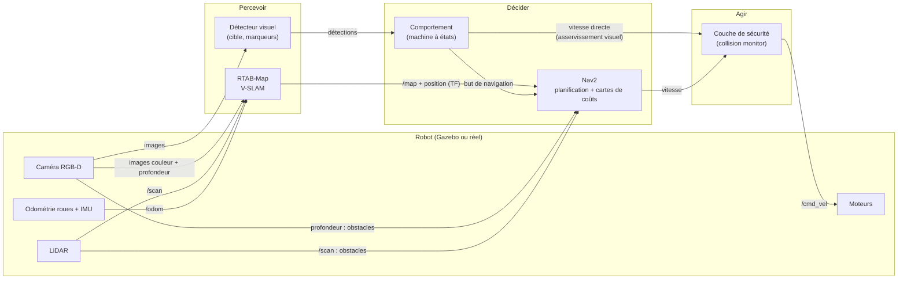
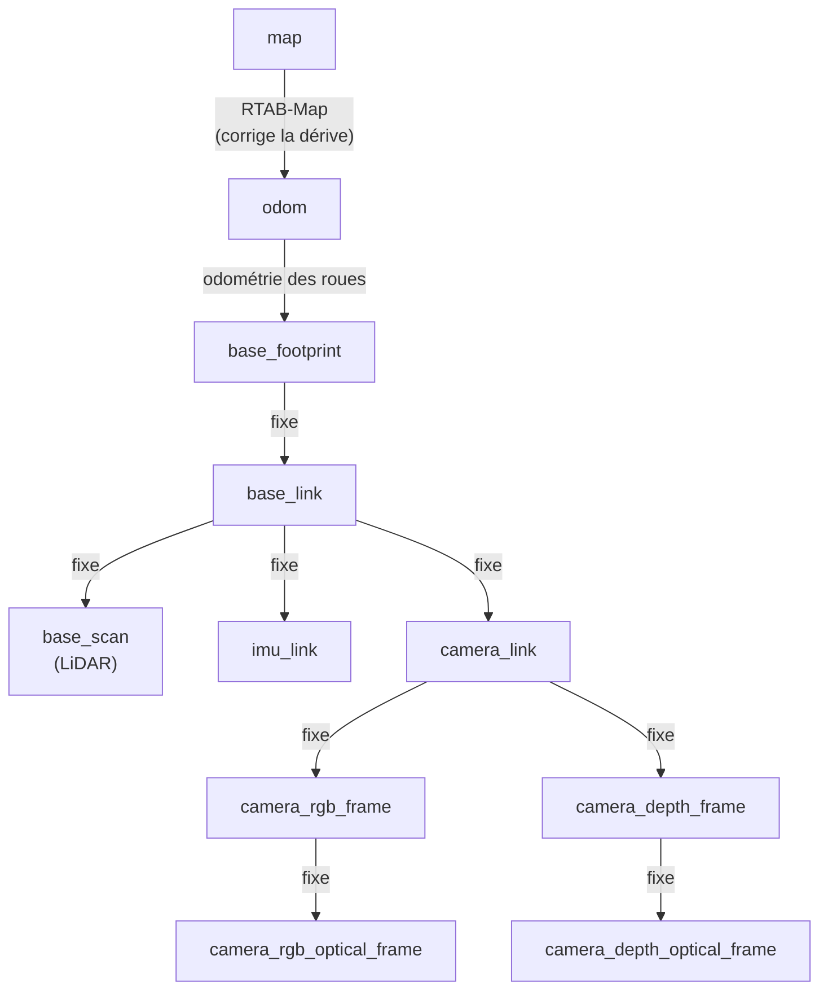

# 03 — Architecture cible

> **Résumé en 3 lignes**
> 1. Le système suit la boucle classique **percevoir → décider → agir**, découpée en nœuds ROS 2 qui ont chacun une seule responsabilité.
> 2. RTAB-Map fournit la carte et la position du robot, Nav2 planifie et évite les obstacles, nos nœuds de perception et de comportement relient la vision aux commandes.
> 3. Cette architecture a été **validée** avec la feuille de route ; elle pourra être ajustée au démarrage de chaque étape, et tout écart sera consigné dans le [registre des décisions](decisions.md).

Statut : **validée** avec la feuille de route (2026-10-24), ajustable étape par étape. Notions utiles : [ROS 2](notions/ros2.md),
[navigation et contrôle](notions/navigation_controle.md), [SLAM](notions/slam_vslam.md).

---

## 1. Principe : percevoir, décider, agir

Un robot autonome répète en boucle trois opérations :

1. **Percevoir** : lire les capteurs et en extraire une information utile (où est la cible ? où sont les obstacles ? où suis-je ?).
2. **Décider** : choisir quoi faire en fonction de cette information et de l'objectif.
3. **Agir** : envoyer des vitesses aux moteurs.

Dans ROS 2, chaque opération est confiée à un ou plusieurs **nœuds** (programmes) qui
s'échangent des **messages** sur des **topics** (canaux nommés).

## 2. Vue d'ensemble



Deux chemins de commande coexistent :

- **navigation planifiée** : le comportement envoie un *but* (une position dans la carte) à Nav2,
  qui calcule le chemin et l'évitement ;
- **asservissement visuel direct** : pour les derniers mètres vers une cible, le comportement
  calcule lui-même les vitesses à partir de l'image (comme le prototype `target_follower`).

Dans les deux cas, la vitesse passe par une **couche de sécurité** qui arrête le robot si un
obstacle est trop proche, quoi que demandent les nœuds en amont.

## 3. Topics principaux

Les noms des topics caméra seront fixés à l'étape E1, quand le modèle RGB-D sera créé.

| Topic | Type de message | Produit par | Utilisé par |
|---|---|---|---|
| `/scan` | `sensor_msgs/LaserScan` | LiDAR | RTAB-Map, Nav2, sécurité |
| `/odom` | `nav_msgs/Odometry` | odométrie des roues | RTAB-Map, Nav2 |
| `/imu` | `sensor_msgs/Imu` | centrale inertielle | (option) fusion d'odométrie |
| `/camera/…/image_raw` (couleur) | `sensor_msgs/Image` | caméra | RTAB-Map, détecteur |
| `/camera/…/image_raw` (profondeur) | `sensor_msgs/Image` | caméra | RTAB-Map, Nav2, détecteur |
| `/camera/…/camera_info` | `sensor_msgs/CameraInfo` | caméra | tous les traitements d'image |
| `/map` | `nav_msgs/OccupancyGrid` | RTAB-Map | Nav2 |
| `/tf`, `/tf_static` | `tf2_msgs/TFMessage` | plusieurs | tous |
| détections (nom à fixer) | `vision_msgs/Detection2DArray` (proposé) | détecteur | comportement |
| `/cmd_vel` | `geometry_msgs/TwistStamped` | sécurité | robot |

## 4. Arbre des repères (TF)

Chaque capteur mesure dans son propre repère. L'arbre TF décrit comment passer de l'un à
l'autre ; noms tirés de l'URDF `turtlebot3_waffle` de Lyrical.



- `map → odom` : publié par le SLAM. La position dans `odom` est continue mais dérive ; le SLAM
  ajoute la correction qui la recale sur la carte.
- `odom → base_footprint` : publié par l'odométrie (en simulation, le plugin *DiffDrive* de Gazebo).
- Les repères **optiques** suivent la convention des caméras (z vers l'avant, x vers la droite,
  y vers le bas), différente de celle du robot (x vers l'avant, y à gauche, z en haut).

> **Point à corriger à l'étape E1 :** dans le modèle Gazebo fourni, les images sont horodatées
> dans `camera_rgb_frame` au lieu de `camera_rgb_optical_frame`. Les axes seraient alors mal
> interprétés et toute reconstruction 3D (nuage de points, SLAM) serait mal orientée. Le modèle
> RGB-D du projet devra utiliser le repère optique (à vérifier visuellement dans RViz).

## 5. Organisation proposée du dépôt

Décision [D-006](decisions.md#d-006--dépôt-organisé-en-plusieurs-paquets) (acceptée), à appliquer au
début de l'étape E1. Aujourd'hui le dépôt contient un seul paquet, `robot_mobile`, à la racine.

```
robot-mobile/                    dépôt Git
├── README.md                    manuel d'exécution
├── docs/                        documentation scientifique (ce dossier)
├── robot_mobile_description/    modèle du robot simulé (TurtleBot3 + caméra RGB-D)
├── robot_mobile_bringup/        lancement : launch, mondes, paramètres YAML, configurations RViz
├── robot_mobile_perception/     nœuds Python de traitement d'image (cible, marqueurs)
└── robot_mobile_control/        nœuds Python de comportement et de commande
```

| Paquet | Type | Contenu | Pourquoi séparé |
|---|---|---|---|
| `robot_mobile_description` | `ament_cmake` | URDF/SDF, maillages | Partagé par la simulation et le robot réel |
| `robot_mobile_bringup` | `ament_cmake` | `launch/`, `worlds/`, `config/`, `rviz/` | Aucune logique : seulement de la configuration |
| `robot_mobile_perception` | `ament_python` | détecteurs, utilitaires de vision | Testable seul, sans faire bouger le robot |
| `robot_mobile_control` | `ament_python` | machine à états, asservissement visuel, sécurité | Indépendant de la façon dont la cible est détectée |

`colcon` trouve automatiquement les paquets dans les sous-dossiers ; le dossier `docs/`, qui n'a
pas de `package.xml`, est ignoré à la compilation.

## 6. Règles de conception

1. **Un nœud, une responsabilité.** La détection ne commande pas les moteurs ; la commande ne traite pas d'image.
2. **Aucune valeur en dur.** Seuils, gains, vitesses, noms de topics sont des **paramètres ROS**
   chargés depuis des fichiers YAML, avec leur unité en commentaire.
3. **Messages standard d'abord** (`sensor_msgs`, `geometry_msgs`, `vision_msgs`) ; un message
   personnalisé seulement si aucun ne convient.
4. **Sans écran.** Les images de contrôle sont publiées sur un topic (visibles dans RViz ou
   `rqt_image_view`), jamais affichées avec `cv2.imshow` : le même code tourne sur le robot.
5. **Sûr par défaut.** Capteur absent ou trop ancien → arrêt ; arrêt envoyé à la fermeture du nœud
   (repris des prototypes).
6. **Temps simulé.** En simulation, tous les nœuds utilisent l'horloge de Gazebo (`use_sim_time: true`).
7. **Une commande par scénario.** Chaque expérience se lance avec un seul `ros2 launch`, ce qui la
   rend répétable et documentable dans la section *Reproduire* des fiches d'étape.

## 7. Questions encore ouvertes

- Le message de détection : `vision_msgs/Detection2DArray` (position dans l'image) ou position 3D
  calculée avec la profondeur ? À trancher à l'étape E3.
- Le robot du labo aura-t-il une caméra RGB-D ([D-004](decisions.md#d-004--hypothèse-sur-le-robot-du-laboratoire)) ?
  Si non, la profondeur viendra du LiDAR et le SLAM visuel deviendra monoculaire ou mixte.
- Fusion de l'odométrie des roues et de l'IMU (`robot_localization`) : utile ou non ? À mesurer à l'étape E2.
