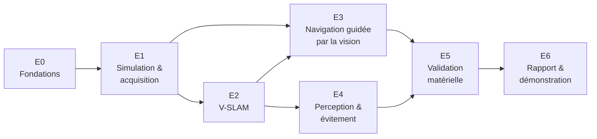

# 04 — Feuille de route

> **Résumé en 3 lignes**
> 1. Le projet est découpé en sept étapes, de E0 (fondations) à E6 (rapport et démonstration), qui suivent les axes du sujet.
> 2. Chaque étape a un objectif, des livrables et un critère « terminé » vérifiable ; elle produit une fiche dans [`etapes/`](etapes/).
> 3. Feuille de route **validée le 2026-10-24** ; les dates des jalons seront fixées après réponse du superviseur, et tout changement ultérieur sera consigné dans le [registre des décisions](decisions.md).

Statut : **validée** (2026-10-24).

---

## 1. Vue d'ensemble

E3 peut commencer dès la fin de E1 pour la partie *asservissement visuel direct* (pas besoin de
carte), puis s'appuyer sur E2 pour la navigation vers des buts dans la carte.

| Étape | Objectif | Exigences | Statut |
|---|---|---|---|
| E0 | Dépôt, documentation, analyse du sujet, feuille de route | LIV-1 (début) | 🟢 terminée |
| E1 | Robot RGB-D simulé dans une scène statique, données capteurs mesurées et enregistrées | EX-SIM-1, EX-SIM-2 | 🟡 en cours |
| E2 | Carte et localisation par RTAB-Map, évaluées par rapport à la vérité terrain | EX-VSLAM-1, EX-VSLAM-2 | 🟢 terminée |
| E3 | Détection visuelle reliée aux commandes de déplacement | EX-VIS-1, EX-VIS-2, EX-TR | ⚪ à faire |
| E4 | Obstacles non cartographiés détectés par la profondeur et évités | EX-EVIT-1, EX-EVIT-2 | ⚪ à faire |
| E5 | Portage sur le robot réel et analyse des écarts | EX-HW-1, EX-HW-2 | ⚪ à faire |
| E6 | Rapport technique et démonstration | LIV-2, LIV-3 | ⚪ à faire |

## 2. Détail des étapes

### E0 — Fondations

- **Objectif** : partir sur une base propre et une méthode de travail documentée.
- **Livrables** : dépôt `robot-mobile` organisé, `.gitignore`, `README.md`, dossier `docs/` (analyse, environnement, état des lieux, architecture, feuille de route, décisions, glossaire, références, notions, modèles).
- **Terminé quand** : la documentation existe, le paquet compile, la feuille de route est discutée.
- **Fiche** : [E0_fondations.md](etapes/E0_fondations.md).

### E1 — Simulation et acquisition des données capteurs

- **Objectif** : lancer en une commande un TurtleBot3 équipé d'une caméra RGB-D dans une scène statique adaptée au SLAM visuel, et caractériser ses capteurs.
- **Tâches** :
  1. Réorganiser le dépôt en paquets ([D-006](decisions.md#d-006--dépôt-organisé-en-plusieurs-paquets)).
  2. Créer le modèle **TurtleBot3 Waffle + caméra RGB-D** (capteur Gazebo `rgbd_camera`), images dans le repère optique.
  3. Créer un monde **texturé** (murs avec motifs, meubles) : le SLAM visuel a besoin de détails visuels pour se repérer. Y placer des cibles.
  4. Configurer le pont Gazebo ↔ ROS 2 (couleur, profondeur, `camera_info`, nuage de points, LiDAR, odométrie, IMU, horloge).
  5. Écrire le fichier launch de simulation et une configuration RViz.
  6. Mesurer fréquences et résolutions (`ros2 topic hz`, `ros2 topic echo --once`), vérifier l'arbre TF (`ros2 run tf2_tools view_frames`).
  7. Enregistrer un **rosbag de référence** (trajet téléopéré) réutilisable pour E2 et E3 sans relancer la simulation.
- **Livrables** : modèle, monde, launch, configuration du pont, configuration RViz, tableau des caractéristiques capteurs, figure de l'arbre TF.
- **Terminé quand** : `ros2 launch …` démarre tout ; tous les topics capteurs publient à la fréquence attendue ; le nuage de points se superpose correctement au scan LiDAR dans RViz.

### E2 — Cartographie visuelle (V-SLAM)

- **Objectif** : construire une carte de la scène avec RTAB-Map et localiser le robot dedans, avec une mesure chiffrée de la qualité.
- **Tâches** :
  1. Installer RTAB-Map ; le configurer en RGB-D + odométrie des roues (+ LiDAR en option).
  2. Cartographier en téléopération ; sauvegarder la base de données et la carte 2D.
  3. Relancer en **mode localisation** sur la carte sauvegardée.
  4. Évaluer : récupérer la vraie position du robot dans Gazebo (vérité terrain), calculer les erreurs **ATE / RPE** avec `evo`, compter les fermetures de boucle, mesurer la charge processeur.
  5. Comparer avec **slam_toolbox** (SLAM au LiDAR seul) sur le même rosbag.
- **Livrables** : launch + paramètres RTAB-Map, carte sauvegardée, tableau d'erreurs, courbes de trajectoire, comparaison argumentée.
- **Terminé quand** : la carte est rechargeable, la localisation fonctionne et les erreurs sont mesurées et interprétées.

### E3 — Navigation guidée par la vision

- **Objectif** : que ce que voit la caméra pilote les déplacements du robot.
- **Tâches** :
  1. Nœud de **perception** unique : détection de la cible colorée (reprise du prototype, paramétrée), publication des détections et d'une image de contrôle.
  2. Ajout de la **distance par la profondeur** et, ensuite, des **marqueurs ArUco** (position et orientation).
  3. Nœud de **comportement** : machine à états *recherche → alignement → approche → arrivée / cible perdue*, rotation et avance simultanées.
  4. Couplage avec Nav2 : un marqueur reconnu devient un but de navigation dans la carte.
  5. Essais répétés : taux de succès, temps, erreur finale ; influence des paramètres (gain, zone morte).
- **Livrables** : paquets `perception` et `control`, fichiers de paramètres, launch, résultats chiffrés.
- **Terminé quand** : le robot atteint la cible dans au moins X % des essais (X à fixer) depuis des positions de départ variées.

### E4 — Perception et évitement d'obstacles non cartographiés

- **Objectif** : détecter avec la profondeur des obstacles qui n'étaient pas là pendant la cartographie, et les contourner.
- **Tâches** :
  1. Installer et configurer Nav2 avec la carte de E2.
  2. Ajouter la caméra de profondeur aux **cartes de coûts** (nuage de points ou `depthimage_to_laserscan`).
  3. Ajouter une **couche de sécurité** (`collision_monitor`) qui ralentit / arrête le robot.
  4. Scénarios : obstacles statiques ajoutés après la cartographie, puis obstacle mobile.
  5. Mesurer : collisions, distance minimale, allongement du trajet.
- **Livrables** : paramètres Nav2, launch de navigation, scénarios Gazebo, résultats chiffrés.
- **Terminé quand** : aucun contact sur N essais par scénario, avec distance minimale mesurée.

### E5 — Validation matérielle

- **Objectif** : rejouer les scénarios sur le TurtleBot3 réel et expliquer les écarts.
- **Tâches** : vérifier la compatibilité ROS 2 PC ↔ robot ; réseau et `ROS_DOMAIN_ID` ; calibration de la caméra ; nouveaux réglages HSV sous l'éclairage du labo ; mesures de latence ; mêmes métriques qu'en simulation.
- **Livrables** : procédure de mise en route du robot, paramètres « réel », tableau comparatif sim / réel.
- **Terminé quand** : au moins un scénario complet de navigation guidée par la vision fonctionne sur le robot réel.

### E6 — Rapport et démonstration

- **Objectif** : livrer le rapport technique et réussir la démonstration.
- **Tâches** : assembler le rapport à partir des fiches d'étape ; définir et répéter le scénario de démonstration ; finaliser le README.
- **Livrables** : rapport, démonstration, dépôt final étiqueté (tag Git).

## 3. Jalons et calendrier

Les dates dépendent des réponses du superviseur (question Q3 de
l'[analyse du sujet](00_analyse_du_sujet.md#5-questions-ouvertes-pour-le-superviseur)).

| Jalon | Contenu | Date |
|---|---|---|
| J1 | Feuille de route validée | ✅ 2026-10-24 |
| J2 | Fin E1 : simulation RGB-D opérationnelle | à fixer |
| J3 | Fin E2 : carte et localisation évaluées | à fixer |
| J4 | Fin E3 + E4 : navigation visuelle et évitement en simulation | à fixer |
| J5 | Fin E5 : essais sur le robot réel | à fixer |
| J6 | Rendu du rapport et démonstration | à fixer |

**Principe face au retard :** pour chaque étape, viser d'abord une **version minimale qui
fonctionne et qui est mesurée**, puis l'améliorer si le temps le permet. Une étape simple mais
évaluée vaut mieux qu'une étape ambitieuse sans résultat.

## 4. Risques

| # | Risque | Probabilité | Impact | Parade |
|---|---|---|---|---|
| R1 | Versions de ROS 2 différentes entre le PC (Lyrical) et le robot (Humble ou Jazzy probable) → communication impossible | élevée | fort | Se renseigner dès maintenant (Q2) ; prévoir un conteneur Docker avec la version du robot |
| R2 | Matériel du labo différent de l'hypothèse (pas de caméra RGB-D) | moyenne | fort | Architecture paramétrable (noms de topics, capteurs) ; plan B : profondeur par le LiDAR |
| R3 | SLAM visuel qui échoue dans une scène peu texturée | élevée en simulation | moyen | Monde texturé (E1) ; fusion avec odométrie et LiDAR dans RTAB-Map |
| R4 | Simulation trop lente (carte graphique hybride) | moyenne | moyen | Rendu NVIDIA, résolution caméra réduite, rosbags pour rejouer sans simuler |
| R5 | Retard sur le calendrier | élevée | fort | Version minimale mesurée par étape ; E3 démarre dès E1 |
| R6 | Écart simulation / réel (éclairage, bruit de profondeur, glissement des roues) | certaine | moyen | Paramètres séparés sim / réel ; prévoir du temps de réglage en E5 |

## 5. Avant de démarrer E1

- [x] Découpage E0 → E6 et critères « terminé » validés (2026-10-24).
- [x] Organisation du dépôt en paquets validée ([D-006](decisions.md#d-006--dépôt-organisé-en-plusieurs-paquets)).
- [ ] Choisir la scène simulée : monde TurtleBot3 existant (`turtlebot3_house`) enrichi de textures, ou monde construit pour le projet. *Première décision de E1.*
- [ ] Envoyer au superviseur les questions Q1 à Q7.
