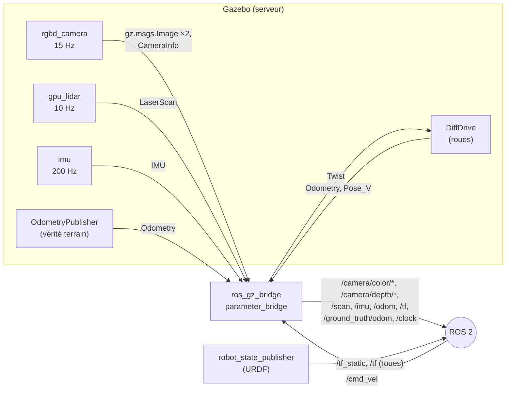
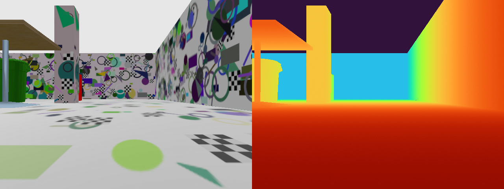
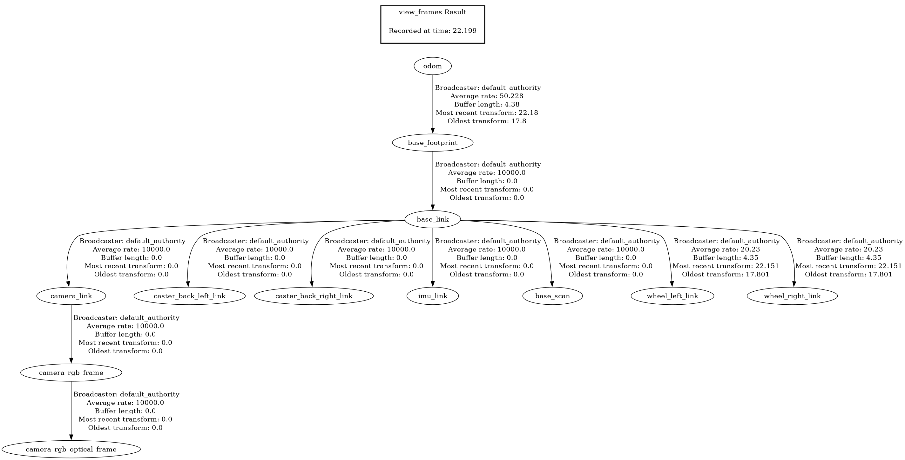
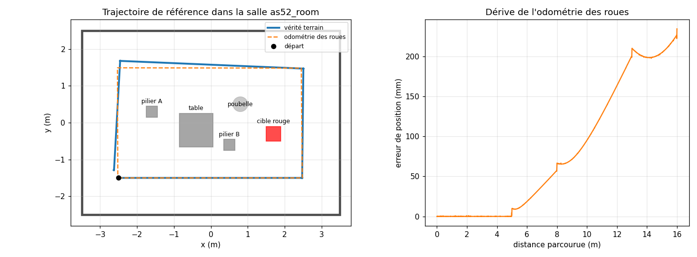
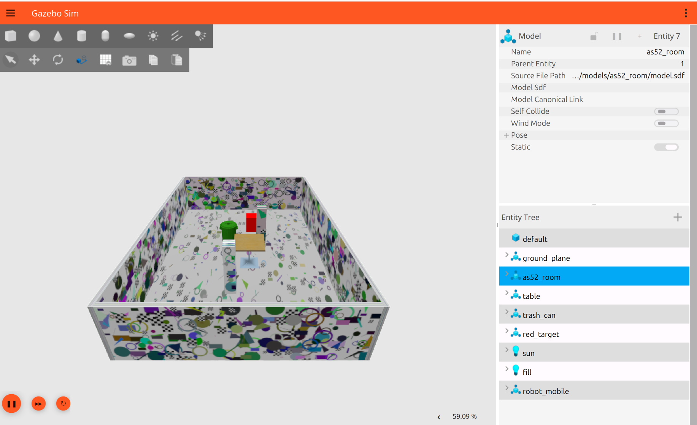
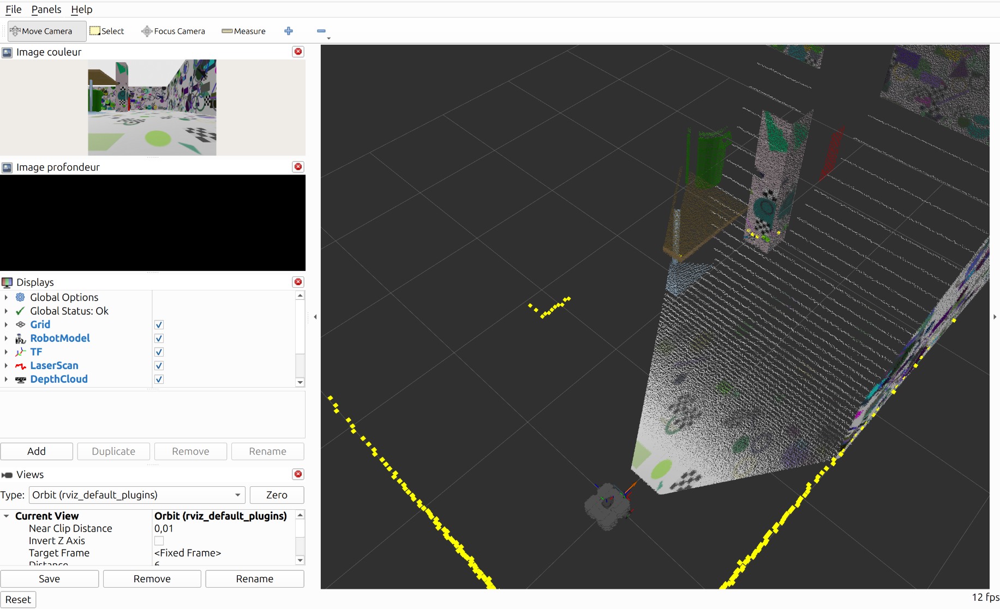
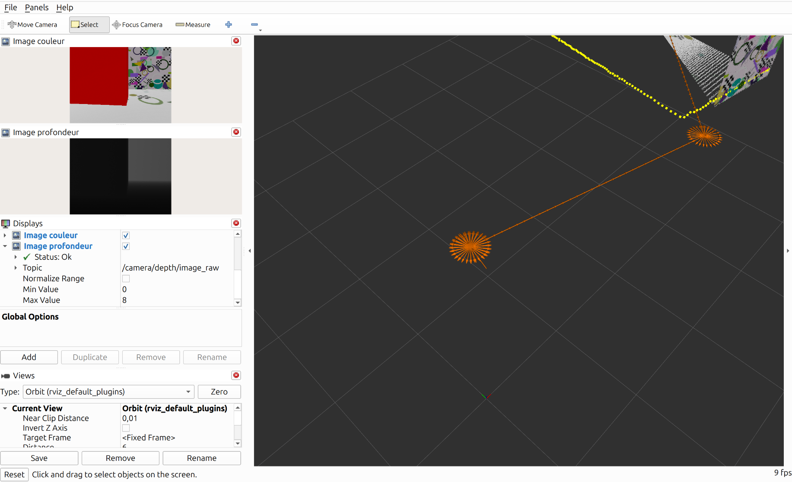

# Étape E1 — Simulation et acquisition des données capteurs

> **Résumé en 3 lignes**
> 1. Un TurtleBot3 Waffle équipé d'une **caméra RGB-D** évolue dans une **salle texturée conçue pour le projet** ; tout se lance en une commande.
> 2. Chaque capteur a été **vérifié par la mesure** : distances comparées à la géométrie connue de la salle (biais ≤ 2,3 mm), fréquences et arbre des repères contrôlés.
> 3. Un **jeu de données de référence** (tour de salle scripté, 103 s, vérité terrain incluse) est enregistré pour E2 et E3 ; il révèle une dérive de l'odométrie de 1,5 % de la distance parcourue.

| Champ | Valeur |
|---|---|
| Statut | 🟢 terminée |
| Dates | début 2026-10-24 — fin 2026-10-25 |
| Exigences couvertes | EX-SIM-1, EX-SIM-2 (voir [analyse du sujet](../00_analyse_du_sujet.md)) |
| Décisions liées | [D-006](../decisions.md#d-006--dépôt-organisé-en-plusieurs-paquets), [D-008](../decisions.md#d-008--description-du-robot--sdf-pour-gazebo-urdf-pour-ros), [D-009](../decisions.md#d-009--caméra-rgb-d-simulée-et-noms-des-topics), [D-010](../decisions.md#d-010--scène-simulée-dédiée-as52_room), [D-011](../decisions.md#d-011--jeu-de-données-de-référence-scripté-et-enregistré) |
| Entrées de journal | [2026-10-24](../journal/2026-10-24_E1_simulation.md) |

---

## 1. Objectif

Lancer en une commande un TurtleBot3 équipé d'une caméra RGB-D dans une scène statique adaptée
au SLAM visuel, et caractériser ses capteurs.

- [x] Une seule commande `ros2 launch` démarre le monde, le robot, le pont ROS 2 et la visualisation.
- [x] Tous les capteurs publient à la fréquence configurée (en temps simulé).
- [x] Les mesures du LiDAR et de la profondeur sont cohérentes avec la géométrie de la salle (vérification chiffrée).
- [x] L'arbre des repères (TF) est complet et conforme à l'[architecture](../03_architecture_cible.md#4-arbre-des-repères-tf).
- [x] Un rosbag de référence, avec vérité terrain, est enregistré et rejouable.
- [x] Contrôle visuel : le nuage de profondeur se superpose aux points du LiDAR dans RViz (§ 8.5).

## 2. Pourquoi cette étape ?

Toutes les étapes suivantes reposent sur les données des capteurs. Si un repère est faux, si une
caméra est mal calibrée ou si une fréquence est trop basse, le SLAM (E2) et la navigation
(E3, E4) échoueront sans qu'on sache pourquoi. Cette étape construit donc la simulation **et**
prouve, chiffres à l'appui, que ce qu'elle produit est correct. Le jeu de données enregistré
permet ensuite de comparer plusieurs algorithmes **sur exactement les mêmes données**.

## 3. Notions nécessaires

- **Caméra RGB-D, LiDAR, odométrie** et leurs limites : [notions/capteurs.md](../notions/capteurs.md).
- **Repères et TF**, **temps simulé**, **rosbag** : [notions/ros2.md](../notions/ros2.md).
- **Biais** (erreur systématique) et **bruit** (erreur aléatoire, mesurée par l'écart-type) :
  on moyenne N mesures ; la moyenne de l'écart est le biais, son écart-type est le bruit.
- **Facteur temps réel (RTF)** : vitesse de la simulation par rapport au temps réel.
  Voir le [glossaire](../glossaire.md).

## 4. Choix techniques et justification

| Question | Retenu | Raison principale | Décision |
|---|---|---|---|
| Organisation du dépôt | paquets `robot_mobile_description` + `robot_mobile_bringup` | séparer le robot de la façon de le lancer | D-006 |
| Description du robot | SDF pour Gazebo + URDF pour ROS | schéma éprouvé, contrôle direct de la physique et des capteurs | D-008 |
| Caméra | `rgbd_camera` 640 × 480, 69,4°, 15 Hz, topics `/camera/color`, `/camera/depth` | résolution usuelle de RTAB-Map / D435, débit réaliste, mêmes noms que les pilotes réels | D-009 |
| Scène | salle dédiée `as52_room` (7 × 5 m), textures générées sans rouge saturé | adaptée au LiDAR et au SLAM visuel, maîtrisée, sans Internet | D-010 |
| Données de référence | trajectoire scriptée + rosbag MCAP zstd + vérité terrain | identique d'un essai à l'autre, rejouable | D-011 |

## 5. Méthodologie

### 5.1 Chaîne d'acquisition



Gazebo calcule la physique et simule les capteurs ; le **pont** traduit leurs messages en
messages ROS 2 ; `robot_state_publisher` publie la position fixe de chaque capteur sur le robot
(lue dans l'URDF). Tous les nœuds utilisent le **temps simulé** (`/clock`).

### 5.2 Le robot simulé

Point de départ : le modèle `turtlebot3_waffle` fourni par ROBOTIS. Chaque modification est
justifiée par un défaut constaté ou un besoin du sujet :

| Modification | Pourquoi |
|---|---|
| Caméra couleur → **caméra RGB-D** (`rgbd_camera`) | le sujet demande la profondeur ; aucun modèle fourni n'en a |
| Images horodatées dans `camera_rgb_optical_frame` | le modèle d'origine utilisait `camera_rgb_frame` : axes mal interprétés pour toute reconstruction 3D |
| `base_footprint` posé au sol (autres liens remontés de 1 cm) | dans le modèle d'origine, il flottait 1 cm au-dessus du sol, contrairement à l'URDF |
| Repère de l'IMU explicite, masses explicites | sinon l'IMU publie dans un repère interne à Gazebo, et chaque lien sans inertie reçoit 1 kg par défaut |
| `frame_id` au lieu de `gz_frame_id`, SDF 1.12 | `gz_frame_id` est obsolète dans Gazebo Jetty |
| Vérité terrain (`OdometryPublisher`) | indispensable pour évaluer le SLAM (E2) |

**Calibration attendue de la caméra.** Pour une caméra sténopé de largeur $W$ pixels et de champ
horizontal $\alpha$ :

$$
f_x = \frac{W/2}{\tan(\alpha/2)} = \frac{320}{\tan(0{,}6056)} \approx 462{,}2 \text{ pixels}
\qquad c_x = 320,\; c_y = 240
$$

### 5.3 La salle `as52_room`

| Élément | Position (m) | Rôle |
|---|---|---|
| Murs (intérieur) | x ∈ [−3,5 ; 3,5], y ∈ [−2,5 ; 2,5], hauteur 1,5 | repères visuels (textures) et LiDAR |
| Pilier A, pilier B | (−1,6 ; 0,3), (0,5 ; −0,6), 0,3 × 0,3 m | repères au centre, visibles par la caméra et le LiDAR |
| Table, poubelle | (−0,4 ; −0,2), (0,8 ; 0,5) | mobilier ; plateau de table invisible au LiDAR (utile en E4) |
| Cible rouge | (1,7 ; −0,3), 0,4 × 0,4 × 0,6 m | cible visuelle pour E3 |
| Départ du robot | (−2,5 ; −1,5), cap 0 | pourtour libre de 1 m pour la trajectoire de référence |

**Textures.** Le script `generate_textures.py` dessine sur chaque surface des formes aléatoires
(disques, anneaux, triangles, damiers) avec une **graine fixe** (résultat reproductible). Trois
règles : densité élevée (beaucoup de coins pour le SLAM), un motif **différent par surface**
(pas deux endroits identiques), **aucune teinte rouge saturée** (teinte OpenCV hors de [20, 160] interdite
si la saturation dépasse 90) pour ne pas créer de fausse cible. Chaque image a le même rapport largeur /
hauteur que la face qu'elle couvre (400 pixels par mètre), donc aucune déformation.



*Vue de la caméra à la position de départ. On reconnaît le mur sud à droite, le mur est au fond,
le pilier B et, derrière lui, un bord de la cible rouge ; la table et la poubelle à gauche.
L'image de profondeur reproduit la même géométrie (le ciel, au-delà de 8 m, est sans mesure).*

### 5.4 Vérification des capteurs par la géométrie

La salle étant un rectangle connu et le simulateur donnant la pose exacte du robot
$(x, y, \theta)$, la distance attendue le long d'un rayon partant du capteur $(p_x, p_y)$ dans la
direction $\varphi$ est la plus petite intersection positive avec les murs :

$$
d_{\text{attendue}} = \min\left( \frac{x_{\text{mur}} - p_x}{\cos\varphi},\; \frac{y_{\text{mur}} - p_y}{\sin\varphi} \right),
\quad x_{\text{mur}} = \pm 3{,}5,\; y_{\text{mur}} = \pm 2{,}5 \text{ selon le signe}
$$

La position $(p_x, p_y)$ du capteur est calculée à partir de la pose vraie **et de TF** :
une erreur dans l'URDF ou le SDF apparaîtrait donc comme un biais. Le script `sensor_check.py`
compare $d_{\text{attendue}}$ à la moyenne de 50 mesures, pour 4 rayons du LiDAR et le pixel
central de la profondeur.

### 5.5 Jeu de données de référence

Trajectoire scriptée (`config/reference_trajectory.yaml`) : un tour de la salle à 1 m des murs,
dans le sens trigonométrique — 4 côtés (5 ; 3 ; 5 ; 3 m) à 0,2 m/s, séparés de 4 virages de 90° sur place à
0,4 rad/s — puis retour au départ. Enregistrement de 14 topics (capteurs, TF, odométrie, vérité
terrain, commandes) au format MCAP compressé, horodaté en temps simulé.

## 6. Implémentation

| Fichier | Rôle |
|---|---|
| [`robot_mobile_description/urdf/robot_mobile.urdf.xacro`](../../robot_mobile_description/urdf/robot_mobile.urdf.xacro) | robot pour ROS (TF, RViz) |
| [`robot_mobile_description/models/robot_mobile/model.sdf`](../../robot_mobile_description/models/robot_mobile/model.sdf) | robot pour Gazebo (physique, capteurs, plugins) |
| [`robot_mobile_bringup/worlds/as52_room.sdf`](../../robot_mobile_bringup/worlds/as52_room.sdf) | monde : lumières, sol, salle, mobilier, cible |
| [`robot_mobile_bringup/models/as52_room/`](../../robot_mobile_bringup/models/as52_room/) | salle et textures |
| [`robot_mobile_bringup/config/gz_bridge.yaml`](../../robot_mobile_bringup/config/gz_bridge.yaml) | correspondance topics Gazebo ↔ ROS 2 |
| [`robot_mobile_bringup/launch/simulation.launch.py`](../../robot_mobile_bringup/launch/simulation.launch.py) | lancement de la simulation |
| [`robot_mobile_bringup/launch/reference_dataset.launch.py`](../../robot_mobile_bringup/launch/reference_dataset.launch.py) | simulation + trajectoire + enregistrement |
| [`robot_mobile_evaluation/.../sensor_check.py`](../../robot_mobile_evaluation/robot_mobile_evaluation/sensor_check.py) | vérification des capteurs (§ 5.4) |
| [`robot_mobile_evaluation/.../reference_trajectory.py`](../../robot_mobile_evaluation/robot_mobile_evaluation/reference_trajectory.py) | trajectoire scriptée |
| [`robot_mobile_evaluation/.../analyze_dataset.py`](../../robot_mobile_evaluation/robot_mobile_evaluation/analyze_dataset.py) | fréquences, dérive de l'odométrie, figure |
| [`robot_mobile_bringup/scripts/generate_textures.py`](../../robot_mobile_bringup/scripts/generate_textures.py) | génération des textures (outil, non installé) |

**Topics produits**

| Topic | Type | Repère | Fréquence configurée |
|---|---|---|---|
| `/camera/color/image_raw` | `sensor_msgs/Image` rgb8, 640 × 480 | `camera_rgb_optical_frame` | 15 Hz |
| `/camera/depth/image_raw` | `sensor_msgs/Image` 32FC1 (m), 640 × 480 | `camera_rgb_optical_frame` | 15 Hz |
| `/camera/{color,depth}/camera_info` | `sensor_msgs/CameraInfo` | `camera_rgb_optical_frame` | 15 Hz |
| `/scan` | `sensor_msgs/LaserScan`, 360 rayons, 0,12 à 3,5 m | `base_scan` | 10 Hz |
| `/imu` | `sensor_msgs/Imu` | `imu_link` | 200 Hz |
| `/odom` + TF `odom → base_footprint` | `nav_msgs/Odometry` | `odom` | 30 Hz (voir § 8.1) |
| `/ground_truth/odom` | `nav_msgs/Odometry` | `world` | 30 Hz |
| `/cmd_vel` (entrée) | `geometry_msgs/TwistStamped` | `base_footprint` | — |

## 7. Protocole expérimental

Toutes les mesures sont faites avec la simulation **sans fenêtre** (`gui:=false rviz:=false`),
sur la machine décrite dans l'[environnement](../01_environnement_logiciel.md).

1. **Facteur temps réel** : rapport temps simulé / temps réel sur 15 s, robot immobile, aucun abonné autre que le pont.
2. **Fréquences** : nombre de messages de chaque topic dans le rosbag de référence, divisé par sa durée **en temps simulé** (indépendant de la vitesse de la simulation).
3. **Capteurs** : `sensor_check.py` au point de départ, robot immobile, 50 acquisitions par capteur.
4. **Arbre TF** : `ros2 run tf2_tools view_frames`.
5. **Odométrie** : trajectoire de l'odométrie des roues ramenée dans le repère du monde (pose vraie au départ), comparée à la vérité terrain le long du tour de référence.
6. **Contrôle visuel** *(à faire)* : `ros2 launch robot_mobile_bringup simulation.launch.py`, puis vérifier dans RViz que le nuage de profondeur coloré se superpose aux points jaunes du LiDAR sur les murs et les piliers, et piloter le robot au clavier.

## 8. Résultats

### 8.1 Performances et fréquences

| Mesure | Valeur |
|---|---|
| Facteur temps réel, robot immobile | **0,91** |
| Facteur temps réel pendant l'enregistrement | **0,83** (95,7 s simulées en 116 s) |
| Charge processeur (Gazebo / pont) | ≈ 160 % / ≈ 45 % d'un cœur ; rendu sur la carte NVIDIA |

| Topic | Messages | Fréquence mesurée (temps simulé) | Configurée |
|---|---|---|---|
| `/camera/color/image_raw` | 1566 | 15,15 Hz | 15 Hz |
| `/camera/depth/image_raw` | 1566 | 15,15 Hz | 15 Hz |
| `/scan` | 1034 | 10,00 Hz | 10 Hz |
| `/imu` | 20 676 | 200,00 Hz | 200 Hz |
| `/ground_truth/odom` | 3041 | 29,41 Hz | 30 Hz |
| `/odom` | 5170 | **50,00 Hz** | 30 Hz |
| `/joint_states` | 103 379 | **1000 Hz** | — |
| `/tf` | 7237 | 70,01 Hz | — |

### 8.2 Capteurs (position de départ, 50 acquisitions)

| Capteur / rayon | Distance attendue | Moyenne mesurée | Biais | Bruit (écart-type) |
|---|---|---|---|---|
| LiDAR, arrière (mur ouest) | 0,935 m | 0,934 m | −1,4 mm | 9,9 mm |
| LiDAR, droite (mur sud) | 1,000 m | 0,998 m | −1,6 mm | 10,1 mm |
| LiDAR, avant et gauche | > 3,5 m (hors portée) | 50/50 « infini » | — | — |
| Profondeur, pixel central (mur est) | 5,932 m | 5,934 m | +2,3 mm | 6,2 mm |

| Calibration caméra | Mesurée | Attendue |
|---|---|---|
| $f_x$, $f_y$ | 462,2 / 462,2 px | 462,2 px |
| $c_x$, $c_y$ | 320,0 / 240,0 px | 320 / 240 px |
| Repère des images | `camera_rgb_optical_frame` | `camera_rgb_optical_frame` |

### 8.3 Arbre des repères



*Arbre TF relevé pendant la simulation : `odom → base_footprint` (odométrie, 50 Hz), puis tous les
repères fixes du robot publiés depuis l'URDF.*

### 8.4 Jeu de données de référence et odométrie

| Mesure | Valeur |
|---|---|
| Enregistrement | `~/as52_data/rosbags/E1_reference_20261024/` — 2,2 Go, 103,4 s simulées, 252 245 messages |
| Distance parcourue (vérité terrain) | 16,00 m |
| Écart entre arrivée et départ (vérité terrain) | 0,251 m |
| Erreur de position de l'odométrie en fin de tour | **0,234 m, soit 1,47 % de la distance** |
| Erreur de cap de l'odométrie en fin de tour | **+4,5°** |



*À gauche : vraie trajectoire (bleu) et trajectoire estimée par l'odométrie des roues (orange
pointillé). À droite : erreur de position de l'odométrie le long du parcours.*

### 8.5 Contrôle visuel (2026-10-25)



*Gazebo avec interface : salle, mobilier et cible conformes au plan ; facteur temps réel affiché
59 % (interface Gazebo + RViz ouvertes, contre 91 % sans fenêtre).*



*RViz : le nuage de profondeur coloré (murs, pilier B, table, poubelle) et les points jaunes du
LiDAR se superposent au pied des murs et du pilier : la caméra et le LiDAR sont bien placés l'un
par rapport à l'autre dans TF.*

Deux points relevés pendant ce contrôle :

| Constat | Diagnostic | Suite |
|---|---|---|
| Le robot ne bougeait pas au clavier | La chaîne `/cmd_vel` → pont → Gazebo fonctionne (le robot avance de 0,22 m avec une commande envoyée par `ros2 topic pub`) ; `teleop_twist_keyboard` lit les touches dans **son propre terminal**, qui doit être la fenêtre active | Commande et consigne précisées dans le README. **Confirmé le 2026-10-25** : le robot de la simulation de l'étudiant avait été déplacé au clavier jusqu'en (1,00 ; −0,49), à 3,6 m du départ |
| Panneau « Image profondeur » entièrement noir | 13 % des pixels valent +∞ (au-delà de 8 m) : avec la normalisation automatique de RViz, toute l'image deviendrait noire ; la configuration la désactive (plage fixe 0–8 m) | **Vérifié le 2026-10-25** : « Normalize Range » est bien décoché, « Max Value » = 8, l'image s'affiche (figure ci-dessous). Le noir complet observé une fois au démarrage ne s'est pas reproduit (probablement transitoire) |



*Panneau « Image profondeur » avec la configuration du projet (plage fixe 0 à 8 m : noir = proche,
blanc = loin). La cible rouge, toute proche, apparaît presque noire ; le mur derrière, plus loin,
en gris.*

## 9. Analyse et discussion

**Les capteurs simulés sont exacts, et la description du robot est cohérente.** Les biais
(≤ 2,3 mm) sont du même ordre que l'incertitude sur la moyenne de 50 mesures
(σ/√50 ≈ 1,4 mm pour le LiDAR) : ils ne sont pas significatifs. Comme la position de chaque capteur
a été lue dans TF, ce résultat valide aussi la cohérence entre l'URDF et le SDF (une erreur de 1 cm
apparaîtrait directement). La calibration de la caméra correspond exactement à la théorie.

**Le bruit simulé est plus favorable que la réalité.** Le LiDAR a le bruit configuré
(σ = 1 cm). La profondeur a un bruit d'environ 6 mm (vraisemblablement le bruit déclaré pour la
caméra, σ = 7 mm, appliqué aussi à la profondeur : il ne dépend pas de la distance), alors que
l'erreur d'une vraie caméra RGB-D croît avec le
carré de la distance (plusieurs centimètres à 5 m) et présente des trous. Le SLAM paraîtra
donc meilleur en simulation que sur le robot : écart à mesurer en E5, et éventuellement à
reproduire en simulation (bruit ajouté) pour tester la robustesse en E2.

**L'odométrie dérive, pour une raison physique identifiable.** La courbe d'erreur montre des
**sauts à chaque virage** (5, 8, 13 m) puis une croissance régulière sur les lignes droites.
Lors des rotations sur place, les roues glissent un peu : le robot tourne d'environ 1,1° de moins
que ce que les roues indiquent. L'odométrie, qui ne voit que les roues, croit avoir fait un
rectangle parfait (tracé orange) ; une petite erreur de cap se transforme ensuite en erreur de
position proportionnelle à la distance parcourue. Avec 1,5 % de la distance parcourue, l'ordre de
grandeur est réaliste pour un robot à roues. **C'est exactement ce que le SLAM devra corriger en
E2**, et ce jeu de données permettra de le mesurer.

**Deux écarts de configuration, sans conséquence.**
- `/odom` est publié à 50 Hz au lieu des 30 Hz demandés : le paramètre `odom_publisher_frequency`
  du plugin *DiffDrive* ne semble pas pris en compte (50 Hz est sa valeur par défaut). 50 Hz est
  plus que suffisant.
- `/joint_states` est publié à chaque pas de physique (1000 Hz) : volume inutile mais faible.

**Performance.** La simulation tourne à 83–91 % du temps réel. Comme tous les nœuds utilisent
le temps simulé, cela n'affecte pas les résultats, seulement la durée des essais. Le pont
consomme près d'un demi-cœur pour convertir les images, même sans abonné.

**Défauts relevés dans les outils** (détail dans le [journal](../journal/2026-10-24_E1_simulation.md)) :
le pont `ros_gz_bridge` plante à l'arrêt (sans perte de données) et le serveur Gazebo peut rester
actif après l'arrêt du lancement (`pkill -x gz-sim-main` pour le fermer).

## 10. Reproduire

```bash
cd ~/Etudes/A2026/AS52/robot-mobile
source /opt/ros/lyrical/setup.bash
colcon build --symlink-install && source install/setup.bash

# Simulation avec affichage (contrôle visuel)
ros2 launch robot_mobile_bringup simulation.launch.py

# Vérification des capteurs (autre terminal, robot immobile au départ)
ros2 run robot_mobile_evaluation sensor_check --ros-args -p use_sim_time:=true

# Arbre TF
ros2 run tf2_tools view_frames --ros-args -p use_sim_time:=true

# Jeu de données de référence (s'arrête seul), puis analyse
ros2 launch robot_mobile_bringup reference_dataset.launch.py output:=$HOME/as52_data/rosbags/E1_reference
ros2 run robot_mobile_evaluation analyze_dataset ~/as52_data/rosbags/E1_reference docs/figures
pkill -x gz-sim-main   # si un serveur Gazebo est resté actif

# Régénérer les textures (uniquement si le décor change)
python3 robot_mobile_bringup/scripts/generate_textures.py robot_mobile_bringup/models/as52_room/textures
```

## 11. Bilan et suites

- **Acquis** : simulation RGB-D complète et vérifiée ; jeu de données de référence avec vérité
  terrain ; outils réutilisables (contrôle des capteurs, analyse).
- **Contrôle visuel** fait : Gazebo, superposition caméra / LiDAR, images couleur et profondeur
  dans RViz, pilotage au clavier (§ 8.5).
- **Transmis à E2** : le rosbag de référence, la vérité terrain, l'erreur de l'odométrie seule
  (0,23 m / 4,5° sur 16 m), qui sert de **point de comparaison** pour le SLAM.
- **Pour E5** : configurer la vraie caméra comme la caméra simulée (640 × 480, 15 Hz, profondeur recalée).

## 12. Messages clés pour la présentation

1. Le robot simulé est un TurtleBot3 Waffle **avec caméra RGB-D**, que nous avons dû créer : aucun modèle fourni n'en avait, et le modèle d'origine contenait deux erreurs de repère que nous avons corrigées.
2. Les capteurs ont été **validés par la mesure** : biais ≤ 2,3 mm par rapport à la géométrie connue de la salle, calibration de la caméra exacte.
3. La salle a été **conçue pour le SLAM visuel** : textures riches, toutes différentes, sans rouge pour ne pas gêner la détection de cible.
4. Un **jeu de données de référence** rejouable est disponible ; il montre que l'odométrie seule dérive de **23 cm (1,5 %) sur 16 m**, à cause du glissement des roues dans les virages : c'est ce que le SLAM devra corriger.
