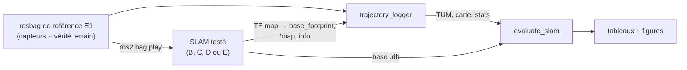
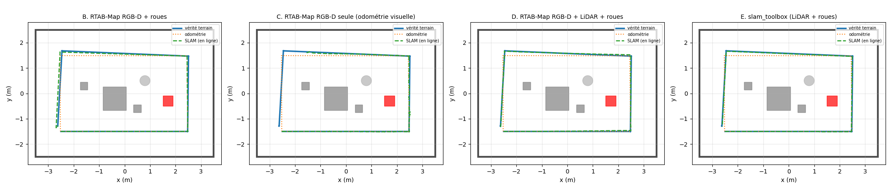
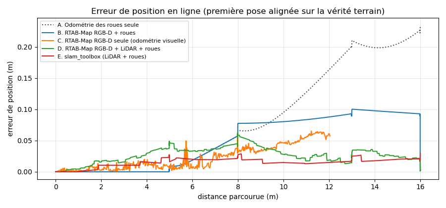
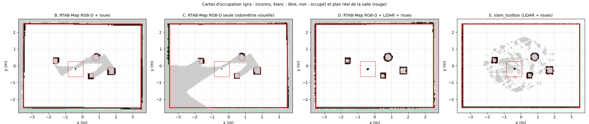
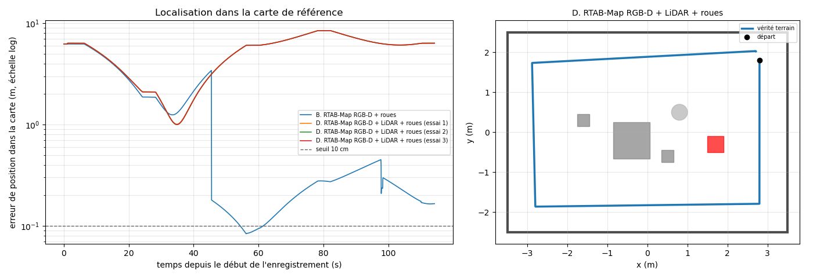
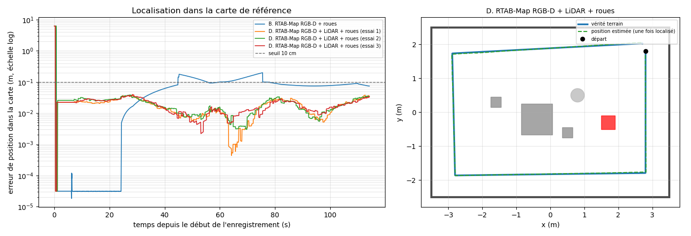

# Étape E2 — Cartographie et localisation visuelle (V-SLAM)

> **Résumé en 3 lignes**
> 1. Cinq méthodes ont été comparées **sur exactement les mêmes données** (le jeu de référence d'E1) : odométrie seule, trois configurations de RTAB-Map (caméra + roues, caméra seule, caméra + LiDAR + roues) et slam_toolbox (LiDAR).
> 2. La démarche a permis de **diagnostiquer puis corriger** les défauts de la configuration visuelle : en limitant le recalage visuel aux points à moins de 4 m, l'erreur de RTAB-Map RGB-D a été divisée par 4 et ses contraintes fausses supprimées.
> 3. Résultat : **RTAB-Map caméra RGB-D + LiDAR + roues** est la plus précise (1 cm en cartographie, 2 cm en localisation sur un nouveau parcours) et est retenue (D-014) ; limite identifiée : sans pose de départ connue, la relocalisation par l'apparence échoue quand les vues diffèrent trop de celles de la carte.

| Champ | Valeur |
|---|---|
| Statut | 🟢 terminée |
| Dates | début 2026-10-25 — fin 2026-10-25 |
| Exigences couvertes | EX-VSLAM-1 (carte), EX-VSLAM-2 (localisation) — voir [analyse du sujet](../00_analyse_du_sujet.md) |
| Décisions liées | [D-005](../decisions.md#d-005--rtab-map-comme-outil-de-v-slam-principal), [D-012](../decisions.md#d-012--paquet-robot_mobile_evaluation-pour-les-outils-dexpérience), [D-013](../decisions.md#d-013--protocole-de-comparaison-des-slam), [D-014](../decisions.md#d-014--configuration-slam-retenue-pour-la-suite), [D-015](../decisions.md#d-015--démarrage-de-la-navigation-depuis-une-pose-connue) |
| Entrées de journal | [2026-10-25](../journal/2026-10-25_E2_vslam.md) |

---

## 1. Objectif

Construire une carte de la salle avec un SLAM visuel, y localiser le robot, et **mesurer** la
qualité obtenue par rapport à la vérité terrain du simulateur.

- [x] Une carte est construite par RTAB-Map et enregistrée (base de données `.db` + carte d'occupation).
- [x] Les erreurs de trajectoire (ATE, RPE) sont mesurées et interprétées pour chaque méthode.
- [x] La comparaison avec l'odométrie seule et avec un SLAM LiDAR (slam_toolbox) est faite.
- [x] La carte enregistrée est rechargée en **mode localisation** sur un nouveau parcours (§ 8.5).

## 2. Pourquoi cette étape ?

L'étape E1 a montré que l'odométrie des roues dérive (23 cm et 4,5° sur un tour de 16 m). Pour
naviguer vers une cible (E3) ou éviter des obstacles avec une carte (E4), le robot a besoin d'une
position fiable dans une carte : c'est le rôle du SLAM. Le sujet demande un SLAM **visuel** ; il
faut donc savoir ce que la caméra apporte réellement, ce qui suppose une comparaison chiffrée.

## 3. Notions nécessaires

- SLAM par graphe, fermeture de boucle, **estimation en ligne et graphe optimisé**, rôle de la
  **covariance**, **aliasing perceptif** : [notions/slam_vslam.md](../notions/slam_vslam.md) (§ 3 à 5).
- **ATE** (erreur absolue de trajectoire, après alignement), **RPE** (erreur relative, dérive locale) :
  [notions/slam_vslam.md § 9](../notions/slam_vslam.md#9-évaluer-un-slam) et [glossaire](../glossaire.md).
- **ICP**, **odométrie visuelle**, **nœud** d'un graphe : [glossaire](../glossaire.md).

## 4. Choix techniques et justification

### 4.1 Méthodes comparées

| | Méthode | Odométrie | Recalage / fermetures de boucle | Carte d'occupation |
|---|---|---|---|---|
| A | odométrie des roues seule | roues | — | — |
| B | RTAB-Map RGB-D + roues | roues | visuel (points d'intérêt) | profondeur |
| C | RTAB-Map RGB-D seule | **visuelle** (`rgbd_odometry`) | visuel | profondeur |
| D | RTAB-Map RGB-D + LiDAR + roues | roues, affinée par ICP LiDAR | visuel + ICP LiDAR | LiDAR + profondeur |
| E | slam_toolbox | roues | LiDAR (corrélation de scans) | LiDAR |

Les réglages de RTAB-Map partent des exemples TurtleBot3 fournis avec RTAB-Map
(`rtabmap_demos`), ceux de slam_toolbox de ses valeurs par défaut ; seuls les réglages propres
à notre robot sont modifiés, avec une justification en commentaire dans
[`config/slam/`](../../robot_mobile_bringup/config/slam/).

### 4.2 Protocole et outils

| Choix | Retenu | Raison | Décision |
|---|---|---|---|
| Données | rejeu du rosbag de référence E1 pour toutes les méthodes | comparaison loyale, même trajectoire | D-013 |
| Métriques | ATE, RPE 1 m, erreur finale, ATE du graphe final, erreur des contraintes de boucle | standards (Sturm 2012) + diagnostic | D-013 |
| Outils | paquet `robot_mobile_evaluation`, métriques testées | code partagé, vérifié avant usage | D-012 |
| Isolation | `ROS_DOMAIN_ID` dédié pendant les essais | une simulation ouverte aurait faussé les données | D-013 |

## 5. Méthodologie

### 5.1 Chaîne d'évaluation



Une commande par essai (`slam_evaluation.launch.py`), un script pour toute la comparaison
(`run_slam_comparison.sh`). Pour chaque essai sont enregistrés : la vérité terrain, l'odométrie,
l'**estimation en ligne** du SLAM (TF `map → base_footprint` telle que le robot la connaît à
chaque instant), la dernière carte et les statistiques de RTAB-Map. Après l'essai, le **graphe
optimisé** est exporté de la base RTAB-Map avec l'instant de chaque nœud (`rtabmap-export`).

### 5.2 Métriques

Toutes les trajectoires sont planes : (temps, x, y, cap).

- **ATE** : on cherche la rotation et la translation qui superposent au mieux l'estimation sur
  la vérité (moindres carrés, méthode de Umeyama), puis

  $$\text{ATE} = \sqrt{\tfrac{1}{N}\textstyle\sum_i \lVert \hat{p}_i - p_i \rVert^2}$$

- **Erreur finale** : la première pose estimée est placée sur la vraie, sans autre ajustement ;
  l'erreur en fin de tour mesure la dérive accumulée, telle que le robot la subit.
- **RPE sur 1 m** : pour chaque paire de poses séparées de 1 m parcouru, écart entre déplacement
  estimé et déplacement vrai (translation en m, rotation en degrés) : mesure la dérive locale.
- **Erreur des contraintes de boucle** (RTAB-Map) : chaque fermeture de boucle affirme un
  déplacement entre deux nœuds ; on le compare au déplacement vrai entre ces nœuds. Une
  contrainte fausse déforme toute la carte : cette mesure sert au **diagnostic**.

### 5.3 Validation de l'outil de mesure

Avant toute comparaison, les métriques ont été vérifiées par des **tests unitaires** sur des cas
dont on connaît la réponse : une trajectoire déplacée d'une transformation rigide connue doit
avoir un ATE nul ; un décalage alterné de ±0,1 m doit donner 0,1 m ; une dérive de cap de 1°/m
doit donner une RPE de 1° ([`test_metrics.py`](../../robot_mobile_evaluation/test/test_metrics.py), 6 tests).
Contrôle supplémentaire : l'odométrie (A), identique dans tous les essais puisqu'elle vient du
même rosbag, obtient exactement les mêmes valeurs à chaque fois (écart-type nul).

### 5.4 Protocole de localisation (partie 2)

Un **second parcours** a été enregistré, volontairement différent du premier : sens **horaire**
(inverse de la cartographie), à 0,7 m des murs (1 m pour la référence), départ au coin nord-est
face au sud (`config/localization_trajectory.yaml`, 18,4 m, 114 s). RTAB-Map est relancé en
**mode localisation** (`Mem/IncrementalMemory = false`) sur une copie de la carte construite
pendant le parcours de référence. L'estimation est comparée à la vérité **sans alignement** :
le repère de la carte est connu exactement (pose de départ du parcours de référence).

Deux scénarios :
1. **Relocalisation globale** (« robot kidnappé ») : RTAB-Map ne connaît pas la pose de départ et
   doit reconnaître la salle par l'apparence.
2. **Pose de départ connue** (`initial_pose`) : situation habituelle d'un robot qui démarre à un
   endroit connu ; il doit ensuite **rester** localisé.

Mesures (`evaluate_localization`) : temps et distance avant relocalisation (première erreur sous
10 cm), puis erreur RMS et maximale, erreur de cap, part du temps sous 10 cm.

### 5.5 Démarche de diagnostic

Quand un résultat contredisait l'attente, une **hypothèse** a été formulée puis **testée par une
mesure** avant de changer un réglage, et un seul réglage a été changé à la fois (§ 8.2).

## 6. Implémentation

| Fichier | Rôle |
|---|---|
| [`config/slam/rtabmap.yaml`](../../robot_mobile_bringup/config/slam/rtabmap.yaml) | réglages communs de RTAB-Map |
| [`config/slam/rtabmap_scan.yaml`](../../robot_mobile_bringup/config/slam/rtabmap_scan.yaml), [`rtabmap_vo.yaml`](../../robot_mobile_bringup/config/slam/rtabmap_vo.yaml) | variantes D (LiDAR) et C (odométrie visuelle) |
| [`config/slam/slam_toolbox.yaml`](../../robot_mobile_bringup/config/slam/slam_toolbox.yaml) | réglages de slam_toolbox |
| [`config/slam/tuning/`](../../robot_mobile_bringup/config/slam/tuning/) | essais de réglage (trace de chaque essai) |
| [`launch/slam.launch.py`](../../robot_mobile_bringup/launch/slam.launch.py) | lance un SLAM (méthode, localisation, réglage supplémentaire) |
| [`launch/slam_evaluation.launch.py`](../../robot_mobile_bringup/launch/slam_evaluation.launch.py) | rejeu + SLAM + enregistrement, arrêt automatique |
| [`scripts/run_slam_comparison.sh`](../../robot_mobile_bringup/scripts/run_slam_comparison.sh) | enchaîne tous les essais puis l'évaluation |
| [`robot_mobile_evaluation/trajectory.py`](../../robot_mobile_evaluation/robot_mobile_evaluation/trajectory.py) | TUM, alignement, ATE, RPE |
| [`trajectory_logger.py`](../../robot_mobile_evaluation/robot_mobile_evaluation/trajectory_logger.py), [`evaluate_slam.py`](../../robot_mobile_evaluation/robot_mobile_evaluation/evaluate_slam.py) | enregistrement d'un essai, comparaison |

Principaux réglages de RTAB-Map (détail et justification dans les fichiers YAML) :

| Paramètre | Valeur | Raison |
|---|---|---|
| `Reg/Force3DoF` | true | robot plan : x, y, cap seulement |
| `Rtabmap/DetectionRate` | 2 Hz | un nœud tous les ~10 cm à 0,2 m/s |
| `odom_tf_linear/angular_variance` | 0,001 | incertitude explicite de l'odométrie (Gazebo annonce 0) — § 8.2 |
| `Vis/MaxDepth` | 4 m | recalage visuel sur les points proches — § 8.2 (réglage T1) |
| `Grid/MaxObstacleHeight` | 0,4 m | au-dessus, le robot (≈ 0,2 m) passe dessous |

## 7. Protocole expérimental

- Données : rosbag de référence E1 (103 s, 16 m, un tour de salle avec retour au départ).
- Rejeu en temps réel ; SLAM et enregistrement en temps simulé ; domaine ROS isolé.
- Répétitions : 3 essais pour B et D (configurations RTAB-Map candidates), 1 pour C et E.
  Le rejeu n'est pas parfaitement déterministe (les images traitées dépendent du temps de calcul) :
  les répétitions mesurent cette variabilité.
- Machine : celle décrite dans l'[environnement](../01_environnement_logiciel.md), aucune autre charge.

## 8. Résultats

### 8.1 Comparaison des méthodes (configuration finale)

Configuration finale (incertitude d'odométrie explicite et `Vis/MaxDepth` = 4 m pour toutes
les variantes RTAB-Map). Moyenne ± écart-type sur les répétitions.

| Méthode | Essais | ATE en ligne (cm) | Erreur finale (cm) | RPE 1 m (cm / °) | ATE graphe final (cm) | Fermetures de boucle | Temps RTAB-Map (ms) |
|---|---|---|---|---|---|---|---|
| A. Odométrie des roues seule | — ¹ | 6,7 | 23,4 | 0,6 / 0,46 | — | — | — |
| B. RTAB-Map RGB-D + roues | 3 | 3,2 ± 0,2 | 0,5 ± 0,2 | 0,8 / 0,44 | 1,0 ± 0,2 | 3,7 ± 0,5 | 86 ± 2 |
| C. RTAB-Map RGB-D seule ² | 1 | 1,8 ² | 5,7 ² | 1,2 / 0,25 | 1,7 ² | 0 | 83 |
| **D. RTAB-Map RGB-D + LiDAR + roues** | 3 | **1,0 ± 0,1** | **0,4 ± 0,1** | 0,9 / 0,27 | **0,8 ± 0,1** | 3,7 ± 0,5 | 98 ± 2 |
| E. slam_toolbox (LiDAR + roues) | 1 | 1,3 | 3,0 | 1,1 / 0,59 | — | — | — |

¹ L'odométrie vient du rosbag : identique pour tous les essais (8 évaluations, écart-type nul).
² Perte de suivi à t = 79,5 s (≈ 12 m sur 16, voir § 8.3) : mesures sur la partie suivie
seulement ; l'« erreur finale » est celle du moment de la perte.

**Qualité des contraintes de fermeture de boucle** (tous essais confondus) :

| Méthode | Contraintes | Erreur médiane (cm) | Erreur max (cm) | > 10 cm |
|---|---|---|---|---|
| B. RTAB-Map RGB-D + roues | 62 | < 0,1 | 6,2 | 0 |
| C. RTAB-Map RGB-D seule | 13 | < 0,1 | 3,6 | 0 |
| D. RTAB-Map RGB-D + LiDAR + roues | 530 | 0,6 | 8,0 | 0 |

D compte beaucoup plus de contraintes : le LiDAR ajoute des contraintes de proximité recalées
par ICP entre nœuds voisins, en plus des fermetures de boucle visuelles.

### 8.2 Réglage de la configuration B (RTAB-Map RGB-D + roues)

La première version de B donnait une estimation en ligne **moins bonne que l'odométrie seule**.
Trois hypothèses ont été testées, une par une.

**H1 — L'odométrie est jugée trop sûre.** Le message `/odom` de Gazebo annonce une covariance
**nulle** : RTAB-Map traite l'odométrie comme parfaite, alors qu'elle se trompe de ~1,1° par virage (E1).
→ Odométrie lue dans TF avec une incertitude explicite (valeurs par défaut de RTAB-Map).

**H2 — Les images sont mal horodatées.** Les pires contraintes concernaient toutes un nœud pris
**pendant une rotation sur place** ; un retard de 0,13 s des images suffirait à expliquer 3°
d'erreur. Test : pendant les rotations, la profondeur au centre de l'image a été comparée à la
distance calculée depuis la vérité terrain, pour différents décalages temporels.

| Décalage testé | −117 ms | −50 ms | −17 ms | +16 ms | +50 ms |
|---|---|---|---|---|---|
| Écart médian (234 images) | 4,2 cm | 1,7 cm | 0,6 cm | 0,7 cm | 1,8 cm |

→ Minimum à 0 ms : **aucun retard, hypothèse rejetée**.

**H3 — Les points lointains faussent le recalage.** La pire contrainte (nœud 111 → nœud 94) avait
97 points cohérents sur 113 et une variance annoncée de 2 cm, mais une erreur réelle de 32 cm et 3° :
RTAB-Map en était très sûr. Les deux vues regardaient à travers toute la salle (points à 5-6 m,
souvent à incidence rasante). → Réglage T1 : `Vis/MaxDepth = 4 m`.

| Réglage de B | Essais | ATE en ligne (m) | RPE 1 m (m) | ATE graphe final (m) | Contraintes > 10 cm | Temps (ms) |
|---|---|---|---|---|---|---|
| Initial (covariance d'odométrie nulle) | 1 | 0,120 | 0,057 | 0,050 | 4 / 35 | 283 |
| + incertitude d'odométrie explicite (H1) | 3 | 0,135 ± 0,057 | 0,050 ± 0,025 | 0,048 ± 0,022 | 14 / 96 | 272 ± 14 |
| + `Vis/MaxDepth` = 4 m (H3, T1) | 3 | **0,032 ± 0,002** | **0,008 ± 0,001** | **0,010 ± 0,002** | **0 / 62** | **86 ± 2** |

- **H1** : effet non significatif sur 3 essais (variabilité trop grande). Réglage conservé car une
  covariance nulle est physiquement fausse.
- **H3** : effet net et reproductible : erreur en ligne divisée par 4, graphe final par 5,
  variabilité divisée par près de 30, plus aucune contrainte fausse, calcul 3 fois plus rapide
  (moins de points à traiter). **Réglage adopté** pour toutes les variantes RTAB-Map.

### 8.3 Odométrie visuelle (C) : perte de suivi

Dans les deux essais C (avant et après le réglage T1), l'odométrie visuelle a **perdu le suivi
au même endroit** — t = 77 s puis t = 79,5 s, côté nord de la salle, vers x ≈ −1,1 à −1,6 m — et ne
l'a jamais retrouvé : les recalages successifs échouent (0 point cohérent), la prédiction de
mouvement diverge (déplacement prédit de 6 m), certaines images demandent jusqu'à 0,5 s de
calcul et des images sont sautées. La perte est donc **reproductible et liée au lieu** ; sa cause
précise n'est pas encore identifiée. Ses métriques ne portent que sur la partie suivie.

### 8.4 Figures de la cartographie



*Vérité terrain (bleu), odométrie seule (orange pointillé), estimation en ligne du SLAM (vert).*



*Erreur de position en ligne (première pose alignée) en fonction de la distance parcourue.*



*Cartes produites (gris : inconnu, blanc : libre, noir : occupé), placées dans le monde avec la
pose vraie de départ, et plan réel de la salle (rouge). La table n'apparaît que par son pied :
son plateau (0,75 m) est au-dessus de la hauteur d'obstacle retenue (0,4 m), et le robot passe dessous.*

### 8.5 Localisation dans la carte (partie 2)

**Scénario 1 — relocalisation globale (pose de départ inconnue)**

| Méthode | Essais | Relocalisation | Erreur RMS après (cm) | Erreur max après (cm) | Temps < 10 cm après |
|---|---|---|---|---|---|
| B. RTAB-Map RGB-D + roues | 1 | après 54 s (8,8 m) | 24,9 | 45,0 | 12 % |
| D. RTAB-Map RGB-D + LiDAR + roues | 3 | **jamais** (0 / 3) | — | — | — |

**Diagnostic.** Près de 200 candidates de relocalisation ont été rejetées dans chaque essai, avec
0 point cohérent. En comparant la position réelle des nœuds candidats de la carte à la position
réelle du robot au même moment : distance médiane **3,4 m**, moins de 15 % des candidates à moins
de 1 m. La reconnaissance par l'apparence propose donc surtout de **mauvais endroits** qui se
ressemblent : par exemple, en longeant le mur sud vers l'ouest, le robot voit le mur ouest comme
lors de la cartographie… mais celle-ci l'avait vu depuis le côté nord, 3,3 m plus loin. Le
parcours inverse ne revoit presque jamais un lieu **sous le même angle** que la carte. Pourquoi D
échoue là où B a réussi une fois n'est pas établi (un seul essai pour B ; piste : le recalage par
ICP de D part de la pose courante, fausse de plusieurs mètres avant relocalisation).

**Scénario 2 — pose de départ connue**

| Méthode | Essais | Erreur RMS (cm) | Erreur max (cm) | Cap RMS (°) | Temps < 10 cm |
|---|---|---|---|---|---|
| B. RTAB-Map RGB-D + roues | 1 | 8,7 | 19,8 | 1,76 | 77 % |
| **D. RTAB-Map RGB-D + LiDAR + roues** | 3 | **2,0 ± 0,0** | **3,9 ± 0,1** | **0,36 ± 0,02** | **100 %** |

Une fois la pose de départ connue, D **reste localisé à 2 cm près sur tout le parcours inverse**,
de façon reproductible ; B dérive entre deux rares relocalisations visuelles, dont une imprécise
(saut de 8 à 18 cm vers 45 s).



*Scénario 1 : erreur de position dans la carte au cours du temps (échelle logarithmique). Avant
relocalisation, l'erreur est de plusieurs mètres (le robot se croit à l'origine de la carte).*



*Scénario 2 : erreur de position (à gauche) et trajectoire estimée par D une fois localisé
(à droite), superposée à la vérité terrain.*

## 9. Analyse et discussion

**Ce qu'apporte le SLAM.** La dérive de l'odométrie (23 cm en fin de tour) disparaît : 0,4 cm
pour D, 0,5 cm pour B. L'ATE est divisé par 2 (B) à 7 (D). Le SLAM corrige la dérive **globale**
au prix de petits sauts au moment des corrections : c'est pourquoi la RPE des SLAM (0,8 à 1,2 cm)
est légèrement moins bonne que celle de l'odométrie (0,6 cm), qui est localement très régulière.
La navigation (E3, E4) devra tolérer ces sauts (c'est le rôle de la transformation `map → odom`).

**Ce qu'apporte la vision, et ce qu'apporte le LiDAR.** La caméra seule sur l'odométrie (B)
corrige la dérive grâce à la **reconnaissance de lieux** par l'apparence. Ajouter le LiDAR (D)
donne le meilleur résultat : l'ICP du LiDAR affine **chaque** déplacement entre nœuds
(précision locale), la vision referme la boucle (cohérence globale). Les deux capteurs sont
**complémentaires**, ce qui rejoint l'esprit du sujet (« caméra RGB-D et LiDAR »).

**Le LiDAR seul est un concurrent sérieux.** slam_toolbox (E) est presque aussi précis en ligne
(1,3 cm) pour un calcul plus léger, mais finit à 3 cm faute de reconnaissance de lieux par
l'apparence. Dans une petite salle où le LiDAR voit toujours des murs à moins de 3,5 m, il est
avantagé ; dans un grand espace ou un couloir répétitif, la vision devient décisive.

**La vision seule est précise mais fragile.** Tant qu'elle suit, l'odométrie visuelle (C) est
plus précise que les roues (1,8 cm). Mais elle a perdu le suivi deux fois au même endroit, sans
jamais repartir : elle ne peut pas servir seule à la navigation sans un repli (roues, IMU).

**Leçons du réglage.**
1. Annoncer une incertitude réaliste pour chaque capteur : une covariance nulle est fausse.
2. Même en simulation, où la profondeur est presque parfaite, les points lointains dégradent le
   recalage visuel ; limiter la profondeur à 4 m a supprimé toutes les contraintes fausses.
3. Une contrainte peut être **fausse et très sûre d'elle** (97 points cohérents sur 113) : le
   nombre de points cohérents ne suffit pas, il faut mesurer l'erreur des contraintes.
4. Changer un seul réglage à la fois et **répéter** les essais : avec un seul essai, l'effet de
   l'incertitude d'odométrie semblait net (ATE du graphe 5,0 → 3,1 cm) ; sur 3 essais, il ne
   l'est pas.

**Localisation : le LiDAR maintient, la vision retrouve… si les vues se ressemblent.** Avec une
pose de départ connue, le LiDAR de D, qui voit à 360° et ne dépend pas de l'angle de vue,
recale le robot en permanence sur la carte : 2 cm d'erreur dans le sens inverse de la
cartographie. La vision seule (B) a besoin de revoir des vues proches de celles de la carte pour
se recaler, et dérive entre-temps. La **relocalisation globale** par l'apparence, elle, échoue
quand les vues diffèrent trop de celles de la carte. Conséquences pratiques : démarrer la
navigation depuis une pose connue ([D-015](../decisions.md#d-015--démarrage-de-la-navigation-depuis-une-pose-connue)),
et, si l'on veut une relocalisation globale robuste, **cartographier dans les deux sens** (ou en
tournant sur place à intervalles réguliers) pour que la carte contienne des vues variées.

**Limites.** Peu de parcours, dans une petite salle ; un seul essai pour C, E et pour B en localisation ; une
simulation favorable (éclairage parfait, profondeur peu bruitée, pas de flou) : les performances
réelles seront moins bonnes (E5). Les damiers identiques présents dans toutes les textures créent
de **fausses ressemblances** (candidates de fermeture rejetées par la vérification géométrique) :
un défaut de conception du décor, sans effet mesuré ici. RTAB-Map demande ≈ 0,1 s par mise à jour
sur le PC ; le Raspberry Pi du TurtleBot3 ne pourra pas le faire tourner : le SLAM tournera sur le
PC en E5.

## 10. Reproduire

```bash
cd ~/Etudes/A2026/AS52/robot-mobile
source /opt/ros/lyrical/setup.bash && colcon build --symlink-install && source install/setup.bash

# Tests des métriques
colcon test --packages-select robot_mobile_evaluation && colcon test-result --verbose

# Comparaison complète (≈ 20 min, sans simulation ouverte ou dans un autre domaine ROS)
robot_mobile_bringup/scripts/run_slam_comparison.sh ~/as52_data/slam_runs/E2_final

# Un seul essai, éventuellement avec un réglage supplémentaire
ROS_DOMAIN_ID=42 ros2 launch robot_mobile_bringup slam_evaluation.launch.py method:=rtabmap_rgbd \
    output:=~/as52_data/slam_runs/essai/rtabmap_rgbd_1 \
    extra_params:=$PWD/robot_mobile_bringup/config/slam/tuning/vis_max_depth_4m.yaml
ros2 run robot_mobile_evaluation evaluate_slam ~/as52_data/slam_runs/essai ~/as52_data/slam_runs/essai/figures

# Localisation sur un second parcours (voir aussi le README)
ROS_DOMAIN_ID=43 GZ_PARTITION=eval ros2 launch robot_mobile_bringup reference_dataset.launch.py \
    trajectory:=$PWD/install/robot_mobile_bringup/share/robot_mobile_bringup/config/localization_trajectory.yaml \
    x:=2.8 y:=1.8 yaw:=-1.5708 output:=~/as52_data/rosbags/E2_localisation
ROS_DOMAIN_ID=42 ros2 launch robot_mobile_bringup slam_evaluation.launch.py localization:=true \
    map_database:=~/as52_data/slam_runs/E2_final/rtabmap_rgbd_scan_1/rtabmap.db \
    bag:=~/as52_data/rosbags/E2_localisation initial_pose:="5.3008 3.3010 0 0 0 -1.5708" \
    output:=~/as52_data/slam_runs/localisation/rtabmap_rgbd_scan_1
ros2 run robot_mobile_evaluation evaluate_localization ~/as52_data/slam_runs/localisation \
    ~/as52_data/slam_runs/E2_final/rtabmap_rgbd_scan_1/ground_truth.tum ~/as52_data/slam_runs/localisation/figures

# SLAM en direct sur la simulation (deux terminaux)
ros2 launch robot_mobile_bringup simulation.launch.py
ros2 launch robot_mobile_bringup slam.launch.py method:=rtabmap_rgbd_scan
```

## 11. Bilan et suites

- **Acquis** : chaîne d'évaluation complète et testée ; comparaison chiffrée de 5 méthodes ;
  deux défauts de configuration diagnostiqués et corrigés ; configuration D retenue pour la suite
  ([D-014](../decisions.md#d-014--configuration-slam-retenue-pour-la-suite)).
- **Localisation** : sur un parcours inverse, D reste localisé à 2 cm près depuis une pose de
  départ connue ; la relocalisation globale par l'apparence échoue (limite documentée, D-015).
- **Pistes facultatives** : comprendre la perte de suivi de l'odométrie visuelle (réinitialisation
  automatique `Odom/ResetCountdown`, stratégie image à image) ; cartographier dans les deux sens
  pour rendre la relocalisation globale possible ; retirer les damiers identiques des textures
  (nécessiterait de nouveaux jeux de données).
- **Transmis à E3 / E4** : le SLAM D fournit `map → odom` et une carte d'occupation propre ;
  la navigation vers une cible pourra s'appuyer sur une position précise au centimètre.

## 12. Messages clés pour la présentation

1. Cinq méthodes ont été comparées **sur les mêmes données**, avec des métriques standard (ATE, RPE) vérifiées par des tests.
2. Le SLAM supprime la dérive de l'odométrie : **23 cm → 0,4 cm** en fin de tour.
3. La meilleure configuration combine **caméra RGB-D, LiDAR et roues** (1 cm d'erreur) : le LiDAR apporte la précision locale, la vision la reconnaissance de lieux.
4. Un défaut a été **diagnostiqué par la mesure** (contraintes de boucle fausses mais « sûres ») et corrigé : erreur divisée par 4, calcul 3 fois plus rapide.
5. La vision seule est précise mais **fragile** (perte de suivi reproductible) : la fusion de capteurs est nécessaire.
6. En **localisation** sur un parcours inverse, la configuration retenue reste à **2 cm** près depuis une pose connue ; sans pose connue, la reconnaissance de lieux échoue car les vues sont trop différentes de la carte : il faudra démarrer d'une pose connue ou cartographier dans les deux sens.
