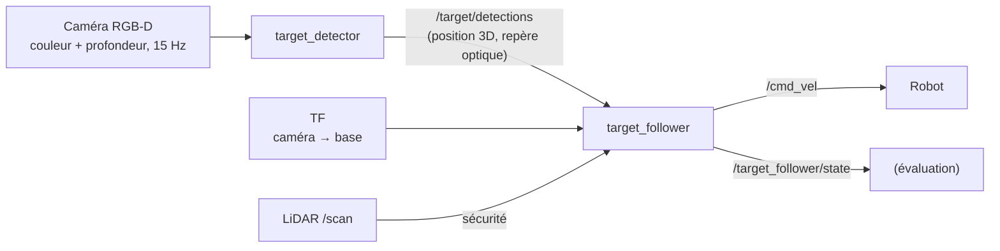
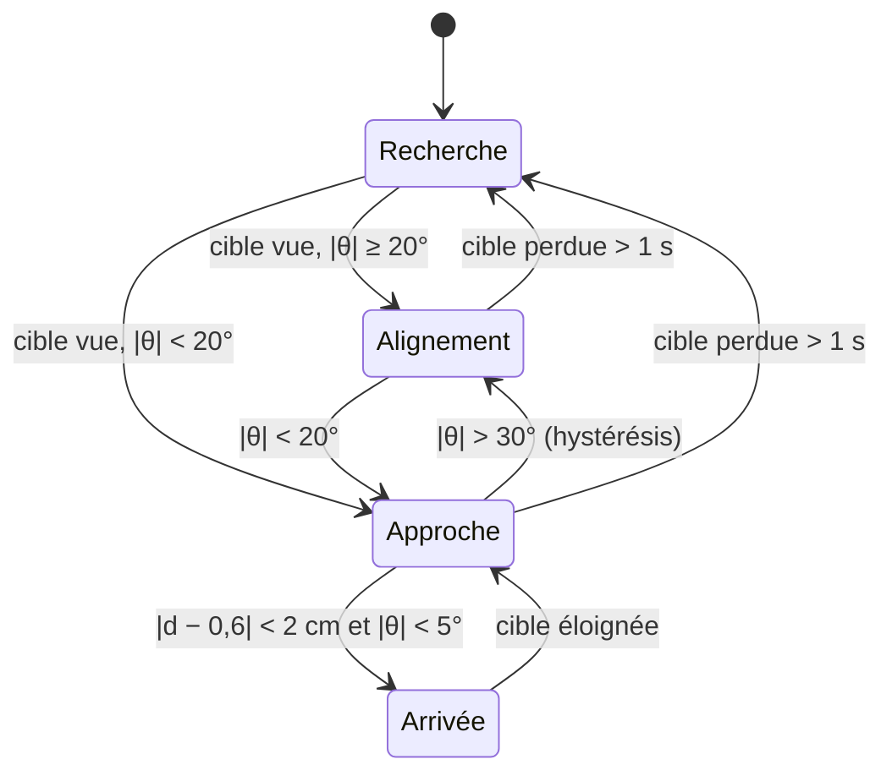
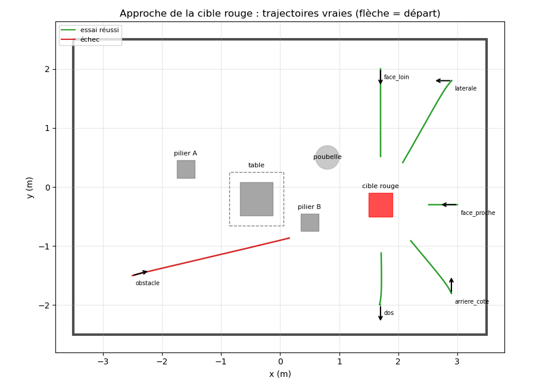

# Étape E3 — Navigation guidée par la vision

> **Résumé en 3 lignes**
> 1. La caméra RGB-D détecte la cible rouge (couleur) et mesure sa position 3D (profondeur) ; un comportement « recherche → alignement → approche → arrivée » commande le robot à partir de cette seule information visuelle.
> 2. Sur 6 départs différents, le robot atteint la cible **dans les 5 cas où la vue est dégagée**, avec un écart moyen de **2,7 cm** sur la distance d'arrêt et **0,6°** sur l'orientation, y compris quand la cible est au départ hors du champ ou dans le dos.
> 3. Limite mesurée : quand un obstacle se trouve entre le robot et la cible, l'approche directe se bloque (sans collision, grâce à la sécurité LiDAR) : c'est ce que résout la navigation planifiée de l'étape E4.

| Champ | Valeur |
|---|---|
| Statut | 🟢 terminée |
| Dates | 2026-10-30 |
| Exigences couvertes | EX-VIS-1, EX-VIS-2, EX-TR, EX-PERC (voir [analyse du sujet](../00_analyse_du_sujet.md)) |
| Décisions liées | [D-016](../decisions.md#d-016--architecture-de-la-navigation-guidée-par-la-vision) |
| Entrées de journal | [2026-10-30](../journal/2026-10-30_E2_E3_E4.md) |

---

## 1. Objectif

Que ce que voit la caméra pilote les déplacements du robot : trouver la cible rouge, s'en
approcher et s'arrêter devant elle à une distance voulue (0,6 m du centre du robot à la face
de la cible).

- [x] La cible est détectée et sa position 3D est publiée, pour chaque image, sous forme d'un message standard.
- [x] La distance est mesurée par la **caméra de profondeur** (et non plus par le LiDAR).
- [x] La détection suit la fréquence de la caméra (≈ 14 Hz, latence ≈ 30 ms), sans fausse détection quand la cible est hors du champ.
- [x] Le comportement gère la cible hors du champ (recherche) et la cible décentrée (alignement).
- [x] Le robot atteint la cible depuis **tous les départs à vue dégagée** (5 / 5), avec une erreur d'arrêt inférieure à 5 cm en moyenne.
- [x] La limite du comportement (obstacle sur la ligne de vue) est identifiée et mesurée.
- [ ] Marqueurs ArUco : reporté (non nécessaire à la démonstration ; voir § 11).

## 2. Pourquoi cette étape ?

C'est le cœur du sujet : « coupler le traitement d'image avec les commandes de déplacement ».
Le prototype de la phase de prise en main (`dev_ws`, voir l'[état des lieux](../02_etat_des_lieux.md#34-target_followerpy--suivi-de-la-cible))
faisait déjà une partie du travail, avec des défauts identifiés : détection dupliquée, distance
mesurée au LiDAR, rotation puis avance, pas de recherche, paramètres en dur, aucune mesure.

## 3. Notions nécessaires

- Couleurs HSV, masque binaire, composante connexe, modèle sténopé et rétroprojection :
  [notions/capteurs.md](../notions/capteurs.md#4-caméra-rgb-d), [glossaire](../glossaire.md).
- Asservissement visuel, régulateur proportionnel, saturation, zone morte, machine à états :
  [notions/navigation_controle.md](../notions/navigation_controle.md#32-asservissement-visuel).

## 4. Choix techniques et justification

| Question | Retenu | Raison |
|---|---|---|
| Découpage | 2 nœuds : `target_detector` (paquet perception) et `target_follower` (paquet contrôle) | la perception se teste sans faire bouger le robot ; la commande ne dépend pas de la façon de détecter |
| Message de détection | `vision_msgs/Detection3DArray`, publié pour **chaque** image (vide si rien n'est vu) | standard ROS ; l'absence de cible devient une information explicite, pas un silence |
| Distance | médiane de la profondeur sur les pixels de la cible | robuste aux trous et aux bords ; mesure la cible elle-même, pas l'obstacle le plus proche |
| Commande | régulateur proportionnel sur l'angle et sur la distance, rotation et avance **simultanées** | trajectoire courbe et fluide (le prototype tournait puis avançait) |
| Sécurité | LiDAR : plus d'avance si un obstacle est à moins de 0,30 m devant ; arrêt si capteurs absents | dernière barrière, quel que soit l'état du comportement |

Décision : [D-016](../decisions.md#d-016--architecture-de-la-navigation-guidée-par-la-vision).

## 5. Méthodologie

### 5.1 Chaîne de traitement



### 5.2 Détection (`color_detection.py`)

1. **HSV** : la teinte $H$ (0-179 dans OpenCV) sépare la couleur de la luminosité ; le rouge est
   aux deux extrémités : $H \in [0, 10] \cup [170, 179]$, avec $S \ge 100$ (couleur franche) et
   $V \ge 60$ (pas trop sombre ; la face à l'ombre de la cible simulée descend vers $V \approx 100$).
2. **Morphologie** : ouverture (retire les petits points isolés) puis fermeture (bouche les trous), noyau elliptique de 5 pixels.
3. **Plus grande composante connexe**, acceptée si son aire dépasse 150 pixels (≈ la cible vue à 6 m).
4. **Profondeur** : $Z$ = médiane des profondeurs valides des pixels de la composante ; centre $(u, v)$ rétroprojeté :
   $X = (u - c_x) Z / f_x$, $Y = (v - c_y) Z / f_y$ (repère optique).

### 5.3 Commande (`approach.py`)

La position 3D est ramenée dans le repère du robot (`base_footprint`) par TF :
angle $\theta = \operatorname{atan2}(y, x)$ (positif à gauche), distance $d = \sqrt{x^2 + y^2}$.

$$
\omega = \operatorname{sat}_{0{,}8}\!\left(1{,}2\,\theta\right)
\qquad
v = \operatorname{sat}_{0{,}2}\!\left(0{,}5\,(d - 0{,}6)\right)\cdot\max(0, \cos\theta)
$$



En **recherche**, le robot tourne sur place (0,5 rad/s) du côté où la cible a été vue en dernier.
En **alignement**, il tourne sans avancer. En **approche**, il tourne et avance à la fois.

## 6. Implémentation

| Fichier | Rôle |
|---|---|
| [`robot_mobile_perception/.../color_detection.py`](../../robot_mobile_perception/robot_mobile_perception/color_detection.py) | détection et position 3D (sans ROS, testé) |
| [`robot_mobile_perception/.../target_detector.py`](../../robot_mobile_perception/robot_mobile_perception/target_detector.py) | nœud de détection |
| [`robot_mobile_control/.../approach.py`](../../robot_mobile_control/robot_mobile_control/approach.py) | machine à états et lois de commande (sans ROS, testé) |
| [`robot_mobile_control/.../target_follower.py`](../../robot_mobile_control/robot_mobile_control/target_follower.py) | nœud de commande |
| [`config/perception/target_detector.yaml`](../../robot_mobile_bringup/config/perception/target_detector.yaml), [`config/control/target_follower.yaml`](../../robot_mobile_bringup/config/control/target_follower.yaml) | paramètres commentés |
| [`launch/target_approach.launch.py`](../../robot_mobile_bringup/launch/target_approach.launch.py) | détection + commande (simulation ou robot réel) |
| [`launch/target_trial.launch.py`](../../robot_mobile_bringup/launch/target_trial.launch.py), [`scripts/run_target_trials.sh`](../../robot_mobile_bringup/scripts/run_target_trials.sh) | un essai mesuré ; tous les scénarios |
| [`robot_mobile_evaluation/.../trial_monitor.py`](../../robot_mobile_evaluation/robot_mobile_evaluation/trial_monitor.py), [`evaluate_target_trials.py`](../../robot_mobile_evaluation/robot_mobile_evaluation/evaluate_target_trials.py) | mesure d'un essai ; comparaison |

**Tests unitaires** : 6 pour la détection (rectangle rouge trouvé au bon endroit, rejet du vert,
du rose pâle et des petites taches, rétroprojection avec une profondeur connue, pixels sans
mesure ignorés, profondeur 16 bits en millimètres des caméras réelles) et 6 pour la machine à
états (recherche, alignement puis approche, saturation et ralentissement, arrivée, obstacle,
recherche du bon côté).

## 7. Protocole expérimental

Simulation sans fenêtre, salle `as52_room`, cible en (1,7 ; −0,3). Un essai réussit quand le
comportement reste dans l'état ARRIVÉE pendant 2 s ; il échoue après 120 s. Les mesures viennent
de la **vérité terrain** du simulateur, pas de ce que le robot croit.

| Scénario | Départ (x, y, cap) | Ce qui est testé |
|---|---|---|
| face_proche | (3,0 ; −0,3 ; 180°) | cible droit devant à 1,1 m |
| face_loin | (1,7 ; 2,0 ; −90°) | cible droit devant à 2,1 m |
| laterale | (2,9 ; 1,8 ; 180°) | cible hors du champ, ≈ 60° à gauche : recherche courte |
| arriere_cote | (2,9 ; −1,8 ; 90°) | cible au bord du champ (≈ 40°), approche en biais |
| dos | (1,7 ; −2,0 ; −90°) | cible dans le dos : demi-tour de recherche |
| obstacle | (−2,5 ; −1,5 ; 16°) | pilier B entre le robot et la cible : limite attendue |

**Mesure de la détection seule** (robot immobile, 30 s par pose, outil `perception_check`) :
cible en vue à 1,1 m (pose de départ de face_proche), puis cible dans le dos (pose de départ de
dos). On compte les images, les messages de détection et ceux qui contiennent la cible ; la
**latence** est l'écart entre l'instant de prise de l'image et la réception de la détection
(transport, synchronisation couleur/profondeur et traitement compris).

**Mesures des essais d'approche** : durée, temps en recherche, **distance finale** du centre du robot à la face de la cible
le long de la ligne de visée (ce que mesure le robot), écart à 0,6 m, **cap final** (écart entre
l'orientation du robot et la direction du centre de la cible), longueur du trajet, **marge
minimale** aux obstacles (robot assimilé à un disque de 0,21 m ; négative = contact ; la table
compte par son socle de 56 cm, car le robot passe sous le plateau).

## 8. Résultats

### 8.1 Détection

| Pose | Images (Hz) | Détections publiées (Hz) | Images avec la cible détectée | Latence moyenne / 95 % / max (ms) | Distance mesurée (m) |
|---|---|---|---|---|---|
| cible en vue à 1,1 m | 14,1 | 14,1 | **100 %** | 30 / 43 / 50 | 1,034 (écart-type < 0,1 mm) |
| cible dans le dos | 14,3 | 14,3 | **0 %** (aucune fausse détection) | 31 / 43 / 55 | — |

Le détecteur répond à chaque image (le 0,5 % manquant correspond aux images en cours de traitement
au début et à la fin de la mesure) : il n'est pas un goulot d'étranglement. La distance attendue
est 1,1 m − 0,069 m (la caméra est 6,9 cm en avant du centre du robot) = 1,031 m : écart de
**2,5 mm**. En simulation, la profondeur est exacte et sans bruit ; ce chiffre vérifie la chaîne
de calcul, pas la caméra réelle.

### 8.2 Approche de la cible

| Scénario | Résultat | Durée (s) | dont recherche (s) | Distance finale (m) | Écart à 0,6 m (cm) | Cap final (°) | Trajet (m) | Marge min. (m) |
|---|---|---|---|---|---|---|---|---|
| face_proche | réussi | 8,4 | 0,0 | 0,618 | +1,8 | 0,0 | 0,48 | 0,29 |
| face_loin | réussi | 13,4 | 0,0 | 0,618 | +1,8 | 0,0 | 1,48 | 0,29 |
| laterale | réussi | 15,4 | 0,8 | 0,581 | −1,9 | +2,7 | 1,63 | 0,38 |
| arriere_cote | réussi | 12,2 | 0,0 | 0,537 | −6,3 | +0,3 | 1,13 | 0,39 |
| dos | réussi | 16,1 | 5,0 | 0,618 | +1,8 | −0,2 | 0,91 | 0,29 |
| obstacle | **échec** (délai) | 120,1 | 0,0 | 1,431 | +83,1 | +5,7 | 2,73 | 0,02 |

**Réussite : 5 / 6 ; 5 / 5 à vue dégagée.** Sur les essais réussis : écart moyen de distance
**2,7 cm**, écart moyen de cap **0,6°**, aucun contact.



*Trajectoires vraies (vert : réussi, rouge : échec ; flèche : départ). On voit les trajectoires
courbes (rotation et avance simultanées) et, dans le scénario « obstacle », le robot bloqué devant
le pilier B.*

**Corrections apportées pendant l'évaluation** (première série refaite, conservée hors Git) :
1. le temps de recherche était mal cumulé (257 s annoncées pour un essai de 16 s) : il est
   désormais calculé à partir de la chronologie des états ;
2. la distance finale était mesurée au point le plus proche de la boîte, alors que le robot mesure
   le long de sa ligne de visée : les deux diffèrent en approche oblique (d'où un écart artificiel
   de −8 cm) ; la mesure suit maintenant la ligne de visée, l'autre reste la marge de sécurité ;
3. la tolérance d'arrivée est passée de 5 à 2 cm : le robot s'arrête en entrant dans la tolérance,
   l'écart final valait donc ≈ 5 cm ; il vaut désormais ≈ 2 cm (+1,8 cm en approche frontale).

## 9. Analyse et discussion

**La vision suffit à guider le robot jusqu'à la cible**, y compris quand elle n'est pas visible
au départ : la recherche la retrouve en moins de 5 s, même dans le dos du robot. La précision
d'arrêt (≈ 2 cm, < 1°) est bien meilleure que ce qu'exige une démonstration.

**L'écart reste plus grand en approche très oblique** (−6,3 cm) : la caméra voit alors deux faces
de la boîte, et la médiane de profondeur porte sur un point plus proche que la face visée.
C'est une limite de la mesure « couleur + médiane de profondeur » sur un objet anguleux ;
une cible plane (affiche, marqueur) la supprimerait.

**Sans planification, un obstacle sur la ligne de vue bloque le robot.** Dans le scénario
« obstacle », le comportement vise la partie de la cible visible à côté du pilier, la sécurité
LiDAR arrête l'avance à 2 cm de marge, et le robot reste bloqué : il ne sait pas contourner. Il
faut une carte et un planificateur : c'est l'objet de l'étape E4 (Nav2), puis de leur combinaison.

**Ce qui changera sur le robot réel** : les seuils HSV devront être réglés sous l'éclairage du labo
(ombres, reflets), la profondeur réelle a des trous et un bruit qui croît avec la distance, et la
latence (Wi-Fi) imposera sans doute de réduire les gains. Les paramètres sont tous dans des
fichiers YAML pour cela.

## 10. Reproduire

```bash
# Approche en direct (deux terminaux), et image de contrôle de la détection
ros2 launch robot_mobile_bringup simulation.launch.py
ros2 launch robot_mobile_bringup target_approach.launch.py
ros2 run rqt_image_view rqt_image_view /target/debug_image

# Mesure de la détection seule (fréquence, taux de détection, latence ; ≈ 2 min)
robot_mobile_bringup/scripts/run_perception_check.sh ~/as52_data/perception/E3

# Tests unitaires
colcon test --packages-select robot_mobile_perception robot_mobile_control && colcon test-result --verbose

# Les 6 scénarios mesurés (≈ 8 min, isolés de toute simulation ouverte)
robot_mobile_bringup/scripts/run_target_trials.sh ~/as52_data/target_trials/E3
```

## 11. Bilan et suites

- **Acquis** : perception et commande séparées, testées, paramétrées ; approche visuelle précise
  depuis des départs variés ; limite (obstacle) mesurée.
- **Reporté** : marqueurs ArUco (`cv2.aruco` est disponible) ; utiles pour identifier plusieurs
  cibles et mesurer leur orientation, non nécessaires à la démonstration.
- **Suite** : combiner avec Nav2 (E4) : aller près de la cible en évitant les obstacles, puis finir
  l'approche à la vision.

## 12. Messages clés pour la présentation

1. La caméra **détecte la cible et mesure sa distance** (couleur + profondeur), à chaque image (14 Hz, 30 ms de latence) ; le robot la rejoint à partir de cette seule information.
2. **5 / 5 réussites à vue dégagée**, arrêt à **2,7 cm** et **0,6°** près en moyenne, même avec la cible dans le dos au départ.
3. Le code est découpé en perception / commande, **testé** (12 tests) et entièrement paramétré.
4. Limite mesurée : un obstacle entre le robot et la cible le bloque (sans collision) — d'où la navigation planifiée d'E4.
