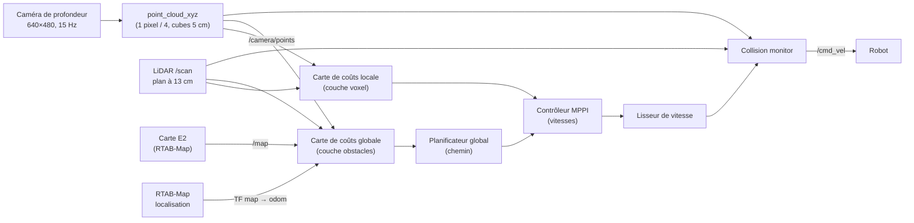
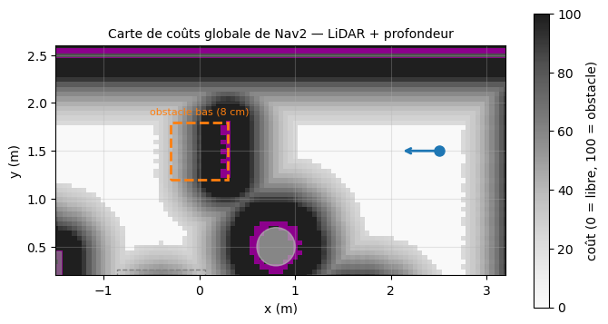
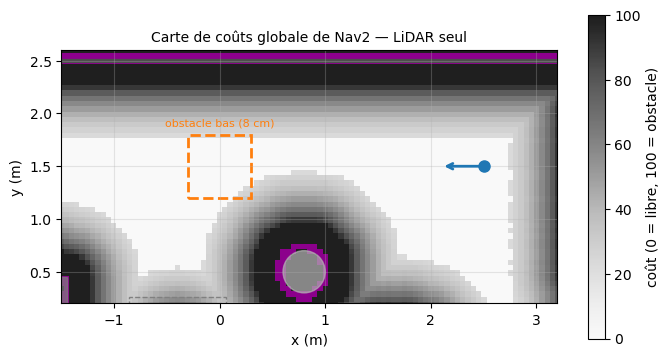
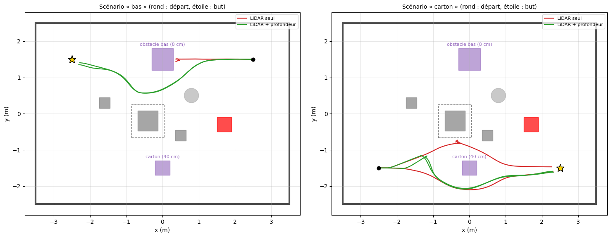

# Étape E4 — Perception de la profondeur et évitement d'obstacles

> **Résumé en 3 lignes**
> 1. Le robot se localise dans la carte d'E2 et Nav2 planifie son trajet ; deux obstacles **absents de la carte** sont posés sur sa route : un carton de 40 cm et un obstacle bas de 8 cm, sous le plan du LiDAR.
> 2. Avec la caméra de profondeur, le robot les contourne **4 fois sur 4, sans aucun contact**. Avec le LiDAR seul, il bute 2 fois sur 2 contre l'obstacle bas, qu'il ne voit pas.
> 3. Pire, il croit alors être arrivé : ses roues patinent, sa position estimée avance et Nav2 annonce « but atteint » alors qu'il est à 2,9 m du but. La profondeur est donc nécessaire, et pas seulement utile.

| Champ | Valeur |
|---|---|
| Statut | 🟢 terminée |
| Dates | 2026-10-30 |
| Exigences couvertes | EX-EVIT-1, EX-EVIT-2, EX-PERC, EX-ROS (voir [analyse du sujet](../00_analyse_du_sujet.md)) |
| Décisions liées | [D-015](../decisions.md#d-015--démarrage-de-la-navigation-depuis-une-pose-connue), [D-017](../decisions.md#d-017--navigation-avec-obstacles-non-cartographiés) |
| Entrées de journal | [2026-10-30](../journal/2026-10-30_E2_E3_E4.md) |

---

## 1. Objectif

Que le robot rejoigne un but éloigné de 5 m en **contournant des obstacles qui n'existaient pas
pendant la cartographie**, détectés par la caméra de profondeur.

- [x] La navigation autonome (planification + suivi de trajectoire) fonctionne dans la carte d'E2.
- [x] Un obstacle ajouté après la cartographie apparaît dans la carte de coûts grâce à la profondeur (§ 8.1).
- [x] Aucun contact avec la profondeur, sur tous les essais, avec la distance minimale mesurée (§ 8.2).
- [x] L'apport de la profondeur est **isolé** : mêmes essais avec et sans elle.
- [ ] Obstacle mobile (personne qui traverse) : non fait, voir § 11.

## 2. Pourquoi cette étape ?

C'est l'axe 4 du sujet : « utiliser la profondeur pour détecter les obstacles non cartographiés
et les éviter dynamiquement ». C'est aussi la réponse à la limite trouvée en E3 : l'approche
visuelle directe se bloque dès qu'un obstacle se trouve entre le robot et la cible, faute de
carte et de planification.

Dans la réalité, la carte n'est jamais à jour : une chaise déplacée, un sac posé par terre, une
personne. Le LiDAR du TurtleBot3 balaie un **plan unique à 13 cm du sol** : tout ce qui est plus
bas (marche, sac, pied de chaise) ou seulement plus haut (plateau de table) lui échappe.
La caméra de profondeur voit un **volume**, d'où l'intérêt de l'ajouter.

## 3. Notions nécessaires

- Planification et contrôle, cartes de coûts, Nav2 : [notions/navigation_controle.md § 5 à 8](../notions/navigation_controle.md#6-nav2).
- Ce que voient le LiDAR et la caméra de profondeur : [notions/capteurs.md](../notions/capteurs.md#2-lidar), [§ 4](../notions/capteurs.md#4-caméra-rgb-d).
- Glissement des roues et odométrie : [notions/capteurs.md § 6](../notions/capteurs.md#6-odométrie-des-roues).
- Termes : *carte de coûts*, *gonflement*, *nuage de points*, *voxel*, *planificateur global / contrôleur local*, *MPPI*, *collision monitor*, *cycle de vie*, *glissement* : [glossaire](../glossaire.md).

## 4. Choix techniques et justification

| Question | Retenu | Raison |
|---|---|---|
| Pile de navigation | **Nav2**, réglages par défaut du TurtleBot3 (planificateur sur grille, contrôleur MPPI) | standard ROS 2, éprouvée ; on mesure l'apport de la profondeur, pas un contrôleur maison |
| Localisation | RTAB-Map en mode localisation dans la carte d'E2 faite dans les deux sens (pas d'AMCL) | même carte et même méthode qu'en E2, mesurées à ≈ 2 cm ([E2 § 8.6](E2_vslam.md#86-carte-construite-dans-les-deux-sens-d-015)) |
| Profondeur → obstacles | image de profondeur → **nuage de points** (`rtabmap_util/point_cloud_xyz`, 1 pixel sur 4, cubes de 5 cm, jusqu'à 3 m) | format accepté directement par les cartes de coûts et le collision monitor ; garde la hauteur de chaque point |
| Points retenus | entre **3 cm et 40 cm** de haut | au-dessus de 3 cm : on ignore le sol (et son bruit) ; au-dessous de 40 cm : ce qui peut heurter le robot |
| Où la profondeur sert | carte de coûts locale (couche voxel), carte de coûts globale (couche obstacles), **collision monitor** | planifier autour, suivre la trajectoire, et freiner en dernier recours |
| Alternative écartée | `depthimage_to_laserscan` (profondeur → faux LiDAR) | aplatit tout sur un plan : on perd justement l'obstacle bas ou la hauteur des objets |

Décision : [D-017](../decisions.md#d-017--navigation-avec-obstacles-non-cartographiés).

## 5. Méthodologie

### 5.1 Chaîne de traitement



1. **Profondeur → points 3D** : chaque pixel $(u, v)$ de profondeur $Z$ devient un point
   $X = (u - c_x) Z / f_x$, $Y = (v - c_y) Z / f_y$, $Z$ (même modèle sténopé qu'en E3), puis il
   est exprimé dans le repère de la carte grâce à TF.
2. **Points → cases** : la carte de coûts est une grille de cases de 5 cm. Une case contenant un
   point entre 3 et 40 cm de haut, à moins de 2,5 m de la caméra, devient « obstacle ». Les cases traversées par un rayon de la
   caméra sans rencontrer d'obstacle sont « libérées » : un obstacle qui disparaît s'efface.
3. **Gonflement** : autour de chaque obstacle, le coût décroît avec la distance (sur 0,7 m) ;
   à moins de 0,22 m (rayon du robot), le centre du robot ne peut pas passer. Le planificateur
   cherche alors le chemin de plus faible coût total, donc celui qui passe au large.
4. **Replanification** : le chemin est recalculé chaque seconde : un obstacle découvert en
   route produit un détour.
5. **Dernier recours** : le collision monitor simule le déplacement du robot sur 1,2 s avec la
   vitesse demandée ; si l'empreinte du robot y rencontre des points d'obstacle (au moins 6), il
   réduit la vitesse pour qu'un contact ne puisse pas survenir avant 1,2 s : le robot ralentit
   jusqu'à l'arrêt.

### 5.2 Ce qui change par rapport aux réglages par défaut de Nav2

Le fichier [`nav2_params.yaml`](../../robot_mobile_bringup/config/navigation/nav2_params.yaml)
est celui de Nav2, avec seulement cinq modifications, listées en tête du fichier :

1. le repère du robot est `base_footprint` ;
2. les vitesses sont envoyées en `TwistStamped`, comme l'attend le TurtleBot3 ;
3. les vitesses maximales sont celles du Waffle (0,22 m/s, 1,0 rad/s) ;
4. la source d'obstacles « profondeur » est ajoutée (§ 4) ;
5. les filtres de zones interdites et de vitesse, inutilisés, sont retirés.

## 6. Implémentation

| Fichier | Rôle |
|---|---|
| [`worlds/as52_room_obstacles.sdf`](../../robot_mobile_bringup/worlds/as52_room_obstacles.sdf) | la salle d'E2 + les 2 obstacles non cartographiés |
| [`config/navigation/nav2_params.yaml`](../../robot_mobile_bringup/config/navigation/nav2_params.yaml) | paramètres Nav2 (§ 5.2) |
| [`launch/navigation.launch.py`](../../robot_mobile_bringup/launch/navigation.launch.py) | localisation RTAB-Map + nuage de points + Nav2 + gestionnaire de cycle de vie ; `use_depth:=false` pour le LiDAR seul |
| [`launch/navigation_trial.launch.py`](../../robot_mobile_bringup/launch/navigation_trial.launch.py), [`scripts/run_navigation_trials.sh`](../../robot_mobile_bringup/scripts/run_navigation_trials.sh) | un essai mesuré ; tous les essais |
| [`robot_mobile_evaluation/.../navigation_trial.py`](../../robot_mobile_evaluation/robot_mobile_evaluation/navigation_trial.py), [`evaluate_navigation_trials.py`](../../robot_mobile_evaluation/robot_mobile_evaluation/evaluate_navigation_trials.py) | envoi du but et mesure d'un essai ; comparaison |
| [`robot_mobile_evaluation/.../costmap_snapshot.py`](../../robot_mobile_evaluation/robot_mobile_evaluation/costmap_snapshot.py), [`scripts/run_costmap_snapshots.sh`](../../robot_mobile_bringup/scripts/run_costmap_snapshots.sh) | image de la carte de coûts (§ 8.1) |

**Deux problèmes rencontrés et corrigés en cours de route** :

1. **Nav2 ne démarrait pas** : tous ses nœuds restaient « non configurés ». Un nœud Nav2 est un
   nœud à *cycle de vie*, qu'un gestionnaire doit configurer puis activer. Sous ROS 2 Lyrical, le
   fichier de lancement `navigation_launch.py` ne contient plus ce gestionnaire (c'est
   `bringup_launch.py`, qui lance aussi AMCL, qui le fait) : `navigation.launch.py` lance donc le sien.
2. **En « LiDAR seul », le robot ne bougeait pas** : le collision monitor attendait toujours la
   source « profondeur », la jugeait invalide et bloquait toute commande par sécurité. La
   variante sans profondeur utilise donc un fichier de paramètres où cette source est retirée
   partout (fonction `nav2_params_file` de `navigation.launch.py`). Les essais faits avant cette
   correction ont été supprimés et refaits.

## 7. Protocole expérimental

La carte est celle d'E2, construite **sans** les obstacles ; le monde simulé, lui, les contient.
Le robot part d'une pose connue (option (a) de [D-015](../decisions.md#d-015--démarrage-de-la-navigation-depuis-une-pose-connue),
la relocalisation globale ayant été vérifiée à part en E2) et reçoit un but à 5 m en ligne droite.

| Scénario | Départ → but (monde) | Obstacle sur la ligne droite | Vu par le LiDAR ? |
|---|---|---|---|
| carton | (−2,5 ; −1,5) → (2,5 ; −1,5), couloir sud | carton 40 × 40 × 40 cm en (0 ; −1,5) | oui |
| bas | (2,5 ; 1,5) → (−2,5 ; 1,5), couloir nord | plaque 60 × 60 × **8 cm** en (0 ; 1,5) | **non** (plan du LiDAR à 13 cm) |

Chaque scénario est joué avec la profondeur (« LiDAR + profondeur ») et sans (« LiDAR seul »),
**2 fois** chacun : 8 essais. Un essai **réussit** si Nav2 annonce le but atteint **et** si le
robot est vraiment (vérité terrain) à moins de 0,30 m du but. Mesures : durée, longueur du trajet,
**marge minimale** à l'obstacle ajouté et aux obstacles de la salle (robot assimilé à un disque
de 0,21 m ; négative = contact ; la table compte par son socle, car le robot passe sous le
plateau).

## 8. Résultats

### 8.1 L'obstacle bas dans la carte de coûts

Robot immobile au départ du scénario « bas », face à l'obstacle à 2,2 m, 30 s après le démarrage :

| LiDAR + profondeur | LiDAR seul |
|---|---|
|  |  |

*Carte de coûts globale de Nav2 (gris : coût, violet : obstacle), couloir nord. Pointillés
orange : l'obstacle bas réel ; point bleu : le robot. Avec la profondeur, la face de l'obstacle
tournée vers le robot est marquée « obstacle » et le couloir se ferme. Avec le LiDAR seul, il
reste entièrement libre : le planificateur y enverra le robot.*

### 8.2 Essais de navigation

| Scénario | Capteurs d'obstacles | Réussis | Contacts | Durée moy. (s) | Trajet moy. (m) | Marge min. à l'obstacle ajouté (m) | Marge min. salle (m) | Statut annoncé par Nav2 |
|---|---|---|---|---|---|---|---|---|
| carton | LiDAR seul | 2 / 2 | 0 | 28,6 | 5,22 | +0,07 | +0,04 | atteint |
| carton | LiDAR + profondeur | 2 / 2 | 0 | 28,5 | 5,44 | +0,08 | +0,21 | atteint |
| bas | LiDAR seul | **0 / 2** | **2** | 27,8 | 2,25 | **−0,14** | +0,60 | **atteint** (faux) |
| bas | LiDAR + profondeur | 2 / 2 | 0 | 27,1 | 5,31 | +0,09 | +0,14 | atteint |

**Avec la profondeur : 4 / 4 réussis, aucun contact. Avec le LiDAR seul : 2 / 4, 2 contacts.**
Avec la profondeur, le détour allonge le trajet de 6 à 10 % (5,3 à 5,5 m au lieu de 5,0 m). L'écart final au but vaut
0,22 à 0,24 m, conforme à la tolérance d'arrivée de Nav2 (0,25 m).



*Trajectoires vraies des 8 essais (vert : LiDAR + profondeur, rouge : LiDAR seul ; rond : départ,
étoile : but ; violet : obstacles ajoutés ; la table est dessinée par son socle, son plateau en
tirets). À gauche, en LiDAR seul, le robot fonce droit sur l'obstacle bas et s'y arrête ; avec la
profondeur, il le contourne par le sud. À droite, les deux variantes contournent le carton.*

## 9. Analyse et discussion

**L'obstacle visible du LiDAR (carton) est évité dans tous les cas.** La profondeur n'y change
presque rien, sauf un comportement plus prudent : avec elle, les deux essais passent au sud du
carton, loin de la table (+0,21 m) ; en LiDAR seul, un essai passe au nord, entre le carton et la
table, à 4 cm du socle de la table. Les deux passages sont libres ; la caméra, qui voit le volume
du carton et le socle de la table (4 cm de haut, sous le LiDAR), rend probablement le passage nord
plus coûteux pour le planificateur (hypothèse non vérifiée).

**L'obstacle bas n'est évité qu'avec la profondeur.** En LiDAR seul, rien n'apparaît dans la carte
de coûts (§ 8.1) : le robot roule droit dessus et s'y bloque, l'avant en appui (marge −0,14 m pour
le disque de 0,21 m, c'est-à-dire l'avant du châssis, à 7 cm du centre, contre l'obstacle).

**Le faux succès est le résultat le plus important de l'étape.** Bloqué contre l'obstacle, le
robot continue de faire tourner ses roues : elles **patinent**. L'odométrie des roues, qui compte
leurs tours, croit donc que le robot avance. RTAB-Map voit pourtant, par la caméra et le LiDAR,
que le robot n'avance pas, mais la correction nécessaire dépasse rapidement la limite qu'il
s'autorise pour une correction (0,20 m, paramètre `Icp/MaxTranslation`) : il la rejette
(« ICP correction too large », 0,37 m, dans le journal de l'essai) et suit l'odométrie. Nav2,
qui se fie à cette localisation, voit le robot progresser, puis arriver : il annonce
**« but atteint » alors que le robot est immobile, à 2,87 m du but**. Ni le contrôle de
progression de Nav2 ni le collision monitor ne peuvent le détecter, puisqu'ils utilisent la même
position estimée et le même LiDAR aveugle.

Conséquences :

1. la caméra de profondeur n'est pas un plus mais une **nécessité** dès qu'il peut y avoir des
   obstacles bas ; c'est l'argument central de l'axe 4 du sujet (EX-PERC : la perception visuelle
   au cœur de la navigation) ;
2. un succès annoncé par le robot ne prouve rien : **l'évaluation doit utiliser une mesure
   indépendante** (ici la vérité terrain du simulateur ; sur le robot réel, une mesure au mètre
   ou au sol du labo) ;
3. sur le robot réel, il faudra surveiller le patinage, par exemple en comparant l'odométrie des
   roues à la rotation mesurée par la centrale inertielle ou à l'odométrie visuelle.

**Les marges restent faibles** (+0,07 à +0,09 m pour le disque de 0,21 m, soit environ 0,14 m
entre le flanc du robot et l'obstacle) : le contrôleur MPPI coupe au plus court dans la zone
gonflée. C'est suffisant en simulation ; sur le robot réel, plus imprécis, on pourra augmenter
le poids du critère d'éloignement des obstacles.

**Limites de l'étude** : 2 essais par cas seulement (en simulation, les deux répétitions donnent
des trajets presque identiques, sauf en LiDAR seul face au carton, où elles contournent par des
côtés différents) ; obstacles statiques ; la profondeur simulée est parfaite. **Ce qui changera sur le robot réel** : la profondeur réelle a
des trous (surfaces noires, brillantes, au soleil) et un bruit qui croît avec la distance, et sa
distance minimale de mesure (de 0,1 à 0,5 m selon le modèle) laisse le robot sans vue juste
devant lui ;
le seuil de 3 cm au-dessus du sol devra peut-être être relevé si le sol réel apparaît en obstacle.

**Fiabilité du démarrage** : sur une vingtaine de lancements de Nav2, deux ont échoué au
démarrage, machine chargée : une fois un nœud Nav2 n'a pas pu répondre au gestionnaire de cycle
de vie (Nav2 reste inactif), une fois l'outil de mesure n'a jamais reçu la carte de coûts. Ce sont
des problèmes de communication au lancement ; il suffit de relancer. À surveiller pour la
démonstration.

## 10. Reproduire

```bash
# Navigation en direct (deux terminaux) : « 2D Goal Pose » dans RViz
ros2 launch robot_mobile_bringup simulation.launch.py \
    world:=$PWD/install/robot_mobile_bringup/share/robot_mobile_bringup/worlds/as52_room_obstacles.sdf
ros2 launch robot_mobile_bringup navigation.launch.py map_database:=<copie de la carte>.db rviz:=true
# (use_depth:=false : LiDAR seul ; initial_pose:="x y 0 0 0 cap" : pose de départ dans la carte)

# Les 8 essais mesurés (≈ 10 min, isolés de toute simulation ouverte)
robot_mobile_bringup/scripts/run_navigation_trials.sh ~/as52_data/nav_trials/E4 \
    ~/as52_data/maps/E2_carte_2_sens_20261030/rtabmap.db 2

# Images de la carte de coûts face à l'obstacle bas (≈ 2 min)
robot_mobile_bringup/scripts/run_costmap_snapshots.sh ~/as52_data/nav_trials/E4_costmap \
    ~/as52_data/maps/E2_carte_2_sens_20261030/rtabmap.db
```

La carte est modifiée par la localisation : `navigation_trial.launch.py` et les scripts
travaillent sur une copie ; en direct, en donner une copie.

## 11. Bilan et suites

- **Acquis** : navigation autonome localisée par la vision (RTAB-Map) ; obstacles non
  cartographiés évités grâce à la profondeur, 4 / 4 sans contact ; apport de la profondeur
  démontré et mesuré, y compris le cas dangereux du faux succès.
- **Non fait** : obstacle mobile ; essais plus nombreux ; réglage des marges.
- **Suite possible** : démonstration intégrée (Nav2 jusqu'aux abords de la cible, puis approche
  visuelle d'E3) ; puis E5, validation sur le robot réel (profondeur réelle, patinage, latence).

## 12. Messages clés pour la présentation

1. Deux obstacles **absents de la carte** : un carton (vu par le LiDAR) et un obstacle de 8 cm (**sous** le LiDAR).
2. Avec la caméra de profondeur : **4 / 4 réussis, aucun contact**, au prix d'un détour de 6 à 10 %.
3. Avec le LiDAR seul : le robot **heurte l'obstacle bas 2 fois sur 2**, et Nav2 annonce même « but atteint » à 2,9 m du but, parce que les roues patinent.
4. Méthode : même pile Nav2 standard, **seule la source « profondeur » change** entre les deux variantes ; mesures par la vérité terrain, jamais par ce que croit le robot.
