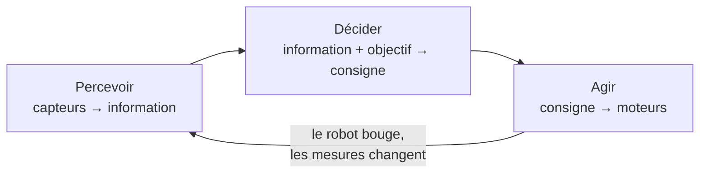
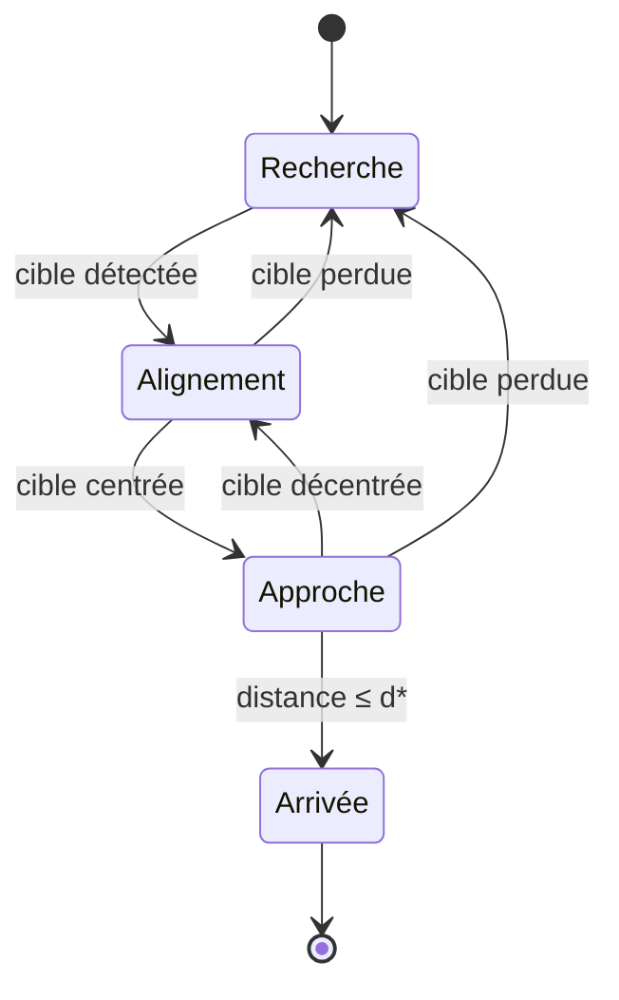

# Notion — Navigation et contrôle

> **Résumé en 3 lignes**
> 1. Commander un robot, c'est fermer la boucle **percevoir → décider → agir** : mesurer l'écart à l'objectif et le corriger en continu.
> 2. On peut réagir directement à ce que voient les capteurs (**réactif**, ex. asservissement visuel) ou planifier un chemin dans une carte (**planifié**, ex. Nav2) ; un robot autonome combine les deux.
> 3. Une **machine à états** organise les comportements, et une **couche de sécurité** a toujours le dernier mot.

---

## 1. La boucle percevoir → décider → agir

Cette boucle tourne à une fréquence fixe (10 Hz dans les prototypes). Plus elle est rapide et
régulière, plus le robot réagit vite : c'est l'enjeu du « temps réel » du sujet.

## 2. Ce qu'on commande : (v, ω)

Un robot différentiel se commande avec deux grandeurs, envoyées dans un `TwistStamped` sur `/cmd_vel` :

- **v** : vitesse linéaire vers l'avant (m/s) — champ `twist.linear.x` ;
- **ω** : vitesse de rotation autour de l'axe vertical (rad/s), positive vers la gauche — champ `twist.angular.z`.

Il ne peut pas se déplacer latéralement. Le pilote convertit (v, ω) en vitesses de roues (voir
[capteurs](capteurs.md#6-odométrie-des-roues)).

## 3. Commande en boucle fermée

### 3.1 Régulateur proportionnel

On mesure une **erreur** *e* (écart entre ce qu'on veut et ce qu'on a) et on applique une
correction proportionnelle :

$$
u = -K_p \, e
$$

- $K_p$ trop petit : le robot corrige lentement ;
- $K_p$ trop grand : il dépasse la consigne et **oscille**.

Deux compléments presque toujours nécessaires :

- **Saturation** : borner la commande ($|u| \le u_{max}$) pour rester dans les capacités du robot ;
- **Zone morte** : ne pas corriger quand $|e|$ est très petit, pour éviter de trembler autour de la consigne.

Les régulateurs **PI / PID** ajoutent un terme intégral (supprime l'erreur résiduelle) et dérivé
(amortit les oscillations), au prix de réglages supplémentaires.

### 3.2 Asservissement visuel

L'erreur est mesurée **directement dans l'image**. Pour centrer une cible d'abscisse $c_x$ dans une
image de largeur $W$ :

$$
e = \frac{c_x - W/2}{W/2} \qquad \omega = \mathrm{sat}(-K_\omega \, e)
$$

Avec la profondeur, on mesure aussi la distance $d$ à la cible et on règle l'avance pour
s'arrêter à une distance voulue $d^*$ :

$$
v = \mathrm{sat}\big(K_v \, (d - d^*)\big)
$$

Appliquer les deux **en même temps** donne une trajectoire courbe et fluide, au lieu de
« tourner puis avancer ».

## 4. Organiser les comportements : la machine à états

Un comportement complet enchaîne plusieurs situations. Une **machine à états** les rend
explicites et testables :

Chaque état a une loi de commande simple ; les transitions sont des conditions mesurables.
Le prototype `target_follower` contenait déjà une version implicite de cette idée (voir
l'[état des lieux](../02_etat_des_lieux.md#34-target_followerpy--suivi-de-la-cible)).

## 5. Réactif ou planifié ?

| | Réactif | Planifié |
|---|---|---|
| Principe | réagir à la mesure du moment | calculer un chemin dans une carte, puis le suivre |
| Besoin d'une carte | non | oui |
| Rapidité de réaction | très bonne | dépend de la fréquence de re-planification |
| Risque | minima locaux (coins, culs-de-sac) | carte fausse ou obstacles absents de la carte |
| Exemple | évitement LiDAR, asservissement visuel | Nav2 |

Un système robuste **combine** les deux : le planificateur choisit l'itinéraire, la couche
réactive gère l'imprévu et la sécurité.

## 6. Nav2

Nav2 [MACENSKI2020] est la pile de navigation standard de ROS 2. Ses éléments principaux :

- **Localisation** : fournie par le SLAM (RTAB-Map en mode localisation) ou par AMCL sur une carte connue.
- **Cartes de coûts** (*costmaps*), en couches superposées :
  - couche **statique** : la carte construite par le SLAM ;
  - couche **obstacles** / **voxels** : les obstacles vus *en ce moment* par le LiDAR ou la caméra de profondeur ;
  - couche **d'inflation** : une marge de sécurité autour de chaque obstacle, liée à la taille du robot.
- **Planificateur global** : calcule un chemin dans la carte de coûts (algorithmes de type A* ou Dijkstra).
- **Contrôleur local** : transforme ce chemin en commandes (v, ω) en tenant compte des obstacles proches.
- **Arbres de comportement** : enchaînent planification, suivi et comportements de secours (reculer, tourner, attendre).
- **Collision monitor** : dernier filet de sécurité qui ralentit ou arrête le robot si un obstacle entre dans une zone définie autour de lui.

On lui envoie un but avec l'action `NavigateToPose`.

## 7. Obstacles non cartographiés

La carte du SLAM est figée au moment de la cartographie. Un carton posé ensuite n'y figure pas.
Pour le voir, on ajoute les capteurs **en direct** dans la couche obstacles / voxels :

- le **LiDAR** voit les obstacles dans son plan ;
- la **caméra de profondeur** voit aussi ce qui est plus bas ou plus haut (pieds de chaise, plateau de table).

La difficulté est de **nettoyer** correctement la carte de coûts quand l'obstacle disparaît, et de
filtrer le bruit de la profondeur (sol vu comme obstacle, points aberrants).

## 8. Sécurité

Quelques règles, quel que soit le comportement :

1. **Capteur absent ou trop ancien → arrêt** (déjà présent dans les prototypes).
2. **Arrêt explicite** envoyé quand un nœud de commande s'arrête.
3. **Vitesses bornées** par des paramètres.
4. Une seule source de commande à la fois vers les moteurs, avec la couche de sécurité en dernier.

Références : [MACENSKI2020], [NAV2-DOC], [SIEGWART2011] dans la [bibliographie](../references.md).
