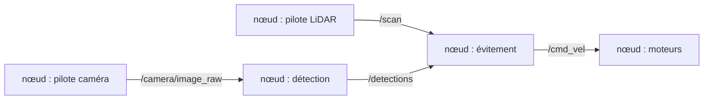

# Notion — ROS 2 en bref

> **Résumé en 3 lignes**
> 1. ROS 2 découpe un logiciel robotique en petits programmes indépendants, les **nœuds**, qui s'échangent des **messages** sur des **topics**.
> 2. Autour de ce principe : des **paramètres** pour régler les nœuds sans toucher au code, des fichiers **launch** pour tout démarrer d'un coup, et **TF** pour suivre la position de chaque repère.
> 3. Ce document donne le vocabulaire minimal pour lire le reste de la documentation.

---

## 1. Pourquoi ROS 2 ?

Un robot mobile fait beaucoup de choses en même temps : lire un LiDAR, traiter des images,
estimer sa position, planifier un chemin, commander ses moteurs. Écrire tout cela dans un seul
programme serait ingérable. **ROS 2** (*Robot Operating System 2*) propose :

- une façon standard de **découper** le logiciel en programmes qui communiquent ;
- des **types de messages communs** (scan laser, image, vitesse…) que tout le monde utilise ;
- des **outils** (visualisation, enregistrement, inspection) ;
- un énorme catalogue de **paquets réutilisables** (SLAM, navigation, pilotes de capteurs…).

Malgré son nom, ce n'est pas un système d'exploitation : c'est une couche logicielle
(*middleware*) qui fonctionne par-dessus Linux.

## 2. Nœuds et topics

Un **nœud** est un programme qui remplit une fonction. Un **topic** est un canal nommé :
des nœuds y **publient** des messages, d'autres s'y **abonnent** pour les recevoir. Celui qui
publie ne sait pas qui écoute : on peut ajouter ou retirer des nœuds sans modifier les autres.



Exemple réel : le prototype `target_follower` s'abonne à `/camera/image_raw` et `/scan`, et
publie sur `/cmd_vel`.

## 3. Messages

Chaque topic transporte un seul **type de message**, une structure de données définie à l'avance.

| Type | Contenu principal | Exemple d'usage |
|---|---|---|
| `sensor_msgs/LaserScan` | `angle_min`, `angle_increment`, tableau `ranges` (distances en m) | scan LiDAR |
| `sensor_msgs/Image` | hauteur, largeur, encodage, tableau de pixels | image couleur ou de profondeur |
| `sensor_msgs/CameraInfo` | paramètres internes de la caméra (focale, centre optique) | projeter un pixel en 3D |
| `nav_msgs/Odometry` | position, orientation, vitesses estimées | odométrie des roues |
| `geometry_msgs/TwistStamped` | horodatage + vitesse linéaire (m/s) et angulaire (rad/s) | commande des moteurs |

Tous les messages de capteurs ont un **en-tête** (`header`) avec l'**instant** de la mesure et le
**repère** dans lequel elle est exprimée.

## 4. Services et actions

- **Service** : question / réponse ponctuelle (ex. : « sauvegarde la carte »).
- **Action** : tâche longue avec suivi de progression et possibilité d'annulation
  (ex. : « va à cette position », l'action `NavigateToPose` de Nav2).

## 5. Paramètres

Un **paramètre** est une valeur de réglage d'un nœud (seuil, gain, vitesse…), lue au démarrage,
généralement depuis un fichier **YAML** :

```yaml
target_detector:
  ros__parameters:
    min_area_px: 200        # aire minimale d'une détection (pixels)
    hue_ranges: [0, 10, 170, 179]
```

Changer un réglage ne demande alors ni de modifier le code ni de recompiler, et chaque
expérience peut être associée au fichier de paramètres exact qui l'a produite.

## 6. Fichiers launch

Un fichier **launch** (en Python, XML ou YAML) démarre en une commande plusieurs nœuds avec
leurs paramètres : `ros2 launch <paquet> <fichier>.launch.py`. Sans launch, chaque essai demande
d'ouvrir plusieurs terminaux et de retaper les commandes, ce qui rend les essais peu répétables.

## 7. Repères et TF

Chaque capteur mesure dans **son propre repère** : un obstacle vu à 1 m devant le LiDAR n'est pas
à 1 m devant le centre du robot. **TF** maintient l'arbre de tous les repères et de leurs
positions relatives, au cours du temps, et permet de convertir une mesure d'un repère à l'autre.

Conventions ROS (REP 103 et REP 105) :

- unités SI : mètres, radians, secondes ;
- repère du robot : x vers l'avant, y vers la gauche, z vers le haut ;
- repères standard d'un robot mobile : `map` (carte, fixe) → `odom` (continu mais qui dérive) → `base_link` (robot).

L'arbre TF du projet est détaillé dans l'[architecture cible](../03_architecture_cible.md#4-arbre-des-repères-tf).

## 8. Qualité de service (QoS)

Chaque abonnement et chaque publication a une **politique de qualité de service**. La plus
importante est la fiabilité :

- **reliable** : chaque message est garanti (retransmis si perdu) ;
- **best effort** : un message perdu est abandonné ; c'est souvent le cas des capteurs, car une
  vieille image n'a plus d'intérêt.

Si un abonné exige *reliable* et que l'éditeur publie en *best effort*, **aucun message ne passe** :
c'est une cause classique de « je ne reçois rien ».

## 9. Temps simulé

En simulation, Gazebo peut aller plus lentement ou plus vite que le temps réel. Il publie donc
sa propre horloge sur `/clock`. Les nœuds lancés avec le paramètre `use_sim_time: true` l'utilisent :
leurs horodatages et leurs minuteurs restent cohérents avec ceux des capteurs simulés.

## 10. Paquets, workspace et compilation

- Un **paquet** regroupe du code et des fichiers de configuration autour d'une fonction ; il est
  décrit par un `package.xml` (nom, dépendances, licence).
- Un **workspace** contient des paquets ; `colcon build` les compile et produit `build/`,
  `install/` et `log/`.
- `source install/setup.bash` rend les paquets compilés utilisables dans le terminal.
- L'option `--symlink-install` évite de recompiler après chaque modification d'un fichier Python
  ou de configuration.

## 11. Commandes utiles

| Commande | Ce qu'elle fait |
|---|---|
| `ros2 topic list -t` | Liste les topics et leurs types |
| `ros2 topic echo /scan --once` | Affiche un message |
| `ros2 topic hz /camera/image_raw` | Mesure la fréquence de publication |
| `ros2 topic info -v /scan` | Montre éditeurs, abonnés et QoS |
| `ros2 node list`, `ros2 node info /nom` | Liste les nœuds et leurs connexions |
| `ros2 param list`, `ros2 param get /nœud nom` | Lit les paramètres |
| `ros2 run tf2_tools view_frames` | Dessine l'arbre TF dans un PDF |
| `ros2 bag record -o essai /scan /odom` | Enregistre des topics |
| `ros2 bag play essai` | Rejoue un enregistrement |
| `rqt_graph` | Affiche le graphe nœuds / topics |

## 12. Lien avec Gazebo

Gazebo a son propre système de messages. Le **pont `ros_gz_bridge`** traduit les topics choisis
dans les deux sens, selon un fichier de configuration (ex. `turtlebot3_waffle_bridge.yaml` fourni
par `turtlebot3_gazebo`) : capteurs de Gazebo vers ROS 2, commandes de vitesse de ROS 2 vers Gazebo.

Pour aller plus loin : [ROS2-DOC], [MACENSKI2022] dans les [références](../references.md).
