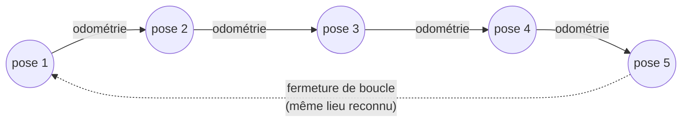

# Notion — SLAM et SLAM visuel (V-SLAM)

> **Résumé en 3 lignes**
> 1. Le **SLAM** construit la carte d'un lieu inconnu tout en y localisant le robot ; il corrige la dérive de l'odométrie grâce aux repères qu'il reconnaît.
> 2. Le **V-SLAM** utilise principalement la caméra ; avec une caméra RGB-D, la profondeur donne l'échelle réelle. RTAB-Map et ORB-SLAM sont deux outils de référence.
> 3. Sa qualité se **mesure** en comparant la trajectoire estimée à la vraie trajectoire (erreurs ATE et RPE), ce qui est facile en simulation.

---

## 1. Le problème de l'œuf et de la poule

- Pour **se localiser**, le robot a besoin d'une **carte** (« je vois ce mur, donc je suis ici »).
- Pour **construire une carte**, il doit savoir **où il est** à chaque mesure (« je vois un mur à 1 m, je suis ici, donc le mur est là »).

Le SLAM (*Simultaneous Localization And Mapping*) résout les deux problèmes **en même temps**.

## 2. Pourquoi l'odométrie ne suffit pas

L'odométrie (roues ou visuelle) estime le déplacement pas à pas. Chaque pas contient une petite
erreur, et ces erreurs **s'accumulent** : c'est la dérive. Sur un aller-retour, la position
estimée à l'arrivée ne coïncide pas avec le point de départ, et une carte construite avec cette
seule estimation devient « tordue » (murs doublés, couloirs qui ne se referment pas).

## 3. Le principe du SLAM par graphe

La plupart des SLAM modernes représentent le problème par un **graphe** :

- **Nœuds** : les positions successives du robot (*poses*), chacune associée à ce que voyaient les capteurs.
- **Arêtes** : des contraintes entre poses, venant de l'odométrie ou de la mise en correspondance de deux observations.
- **Optimisation** : on cherche les poses qui respectent au mieux toutes les contraintes à la fois.
  Quand une contrainte de fermeture de boucle contredit l'odométrie accumulée, l'optimisation
  **répartit l'erreur** sur toute la boucle et la carte se « redresse ».

On distingue souvent :
- le **front-end**, qui traite les capteurs (extraire des points d'intérêt, les associer d'une image à l'autre, détecter les fermetures de boucle) ;
- le **back-end**, qui optimise le graphe.

## 4. Fermeture de boucle

Moment où le robot **reconnaît un lieu déjà visité**. C'est l'événement qui permet de corriger la
dérive. Une fausse fermeture (deux lieux différents qui se ressemblent) est dangereuse : elle
déforme la carte. Les SLAM vérifient donc géométriquement chaque candidat avant de l'accepter.

### 4.1 Estimation en ligne et graphe optimisé

Un SLAM fournit deux trajectoires différentes, à ne pas confondre :

- **l'estimation en ligne** : la position que le robot connaît **à l'instant t**, avec les
  seules informations reçues jusque-là. C'est celle qu'utilise la navigation. Elle avance
  avec l'odométrie et fait des **sauts** à chaque correction (fermeture de boucle).
- **le graphe optimisé final** : toutes les poses recalculées **après coup**, en tenant compte
  de toutes les fermetures de boucle, y compris celles qui sont arrivées plus tard. C'est la
  meilleure reconstruction possible, mais le robot ne la connaissait pas pendant son trajet.

Une fermeture de boucle tardive corrige parfaitement le graphe final mais n'aide pas le robot
pendant le trajet : les deux doivent donc être évaluées séparément.

### 4.2 La confiance accordée à chaque mesure

L'optimisation du graphe pondère chaque contrainte par sa **covariance** (son incertitude
annoncée) : une contrainte très sûre est respectée presque exactement, une contrainte incertaine
peut être « tordue » pour satisfaire les autres. Si une mesure annonce une incertitude nulle
alors qu'elle se trompe (cas de l'odométrie simulée, voir E2), l'optimiseur lui fait trop
confiance et corrige mal les autres poses. Régler les incertitudes est donc aussi important
que les mesures elles-mêmes.

### 4.3 Aliasing perceptif

Deux endroits différents qui se ressemblent (couloirs identiques, motifs répétés) peuvent être
confondus : c'est l'**aliasing perceptif**. La détection par apparence propose alors une fausse
fermeture de boucle ; la **vérification géométrique** (les points appariés doivent correspondre
à un même déplacement 3D cohérent) sert à la rejeter. Concevoir un environnement de test sans
motifs répétés, ou des descripteurs plus discriminants, réduit ces fausses alertes.

## 5. Spécificités du SLAM visuel

- On extrait de chaque image des **points d'intérêt** (coins, détails texturés) décrits par une
  signature (ex. descripteurs ORB), qu'on retrouve d'une image à l'autre.
- Avec **une seule caméra** (monoculaire), on ne connaît pas l'échelle : on ne sait pas si l'on
  voit un petit objet proche ou un grand objet lointain.
- Avec une **caméra RGB-D**, chaque point d'intérêt a une profondeur mesurée : la carte est
  directement à l'**échelle réelle**.
- Difficultés : **scènes peu texturées** (murs unis : rien à suivre), changements d'éclairage,
  objets qui bougent, rotations rapides (flou).

## 6. RTAB-Map

*Real-Time Appearance-Based Mapping* [LABBE2019].

- **Entrées** : caméra RGB-D ou stéréo, et en option LiDAR, odométrie des roues, IMU.
- **Détection de fermeture de boucle par l'apparence** : chaque image est résumée par un « sac de
  mots visuels » ; une nouvelle image est comparée rapidement à toutes les précédentes.
- **Gestion de la mémoire** : seule une partie du graphe est gardée en mémoire de travail, ce qui
  permet de tenir le temps réel sur de grandes cartes.
- **Sorties** : la transformation `map → odom`, une **carte d'occupation 2D** (utilisable par Nav2),
  un nuage de points 3D, et une base de données (`.db`) qui contient toute la session.
- **Deux modes** : *cartographie* (construire la carte) et *localisation* (se repérer dans une carte
  existante sans la modifier).

## 7. ORB-SLAM3

[CAMPOS2021], successeur d'ORB-SLAM2 [MURARTAL2017].

- SLAM visuel par points d'intérêt **ORB**, monoculaire, stéréo ou RGB-D, avec ou sans IMU.
- Trois traitements en parallèle : suivi de la caméra, cartographie locale, fermeture de boucle.
- Gère plusieurs cartes (*Atlas*) et les fusionne quand il reconnaît un lieu commun.
- Très précis en trajectoire, mais produit une carte de points 3D éparse, **pas une carte
  d'occupation** directement utilisable pour la navigation, et **pas de paquet ROS 2 officiel**.

## 8. Comparaison et choix

| Critère | RTAB-Map | ORB-SLAM3 | slam_toolbox (LiDAR) |
|---|---|---|---|
| Capteur principal | RGB-D / stéréo (+ LiDAR) | caméra (mono, stéréo, RGB-D) | LiDAR 2D |
| Paquet ROS 2 Lyrical | oui | non | oui |
| Carte d'occupation pour Nav2 | oui | non | oui |
| Fusion odométrie roues | oui | non | oui |
| Rôle dans le projet | **outil principal** | alternative citée | **référence de comparaison** |

Décision correspondante : [D-005](../decisions.md#d-005--rtab-map-comme-outil-de-v-slam-principal).

## 9. Évaluer un SLAM

En simulation, Gazebo connaît la **vraie position** du robot (vérité terrain). On enregistre la
trajectoire estimée et la vraie, puis on calcule [STURM2012] :

- **ATE** (*Absolute Trajectory Error*) : après avoir superposé au mieux les deux trajectoires,
  l'écart quadratique moyen entre positions estimées $\hat{p}_i$ et vraies $p_i$ :

$$
\text{ATE}_{\text{RMSE}} = \sqrt{\frac{1}{N} \sum_{i=1}^{N} \lVert \hat{p}_i - p_i \rVert^2}
$$

- **RPE** (*Relative Pose Error*) : erreur sur le **déplacement** entre deux instants séparés
  d'un intervalle fixe ; mesure la dérive locale, indépendamment des erreurs passées.

L'outil `evo` [EVO] calcule ces deux erreurs et trace les trajectoires. On complète par des
indicateurs qualitatifs (carte visuellement cohérente avec le monde) et de coût (charge
processeur, fréquence de mise à jour).

Références : voir la [bibliographie](../references.md).
